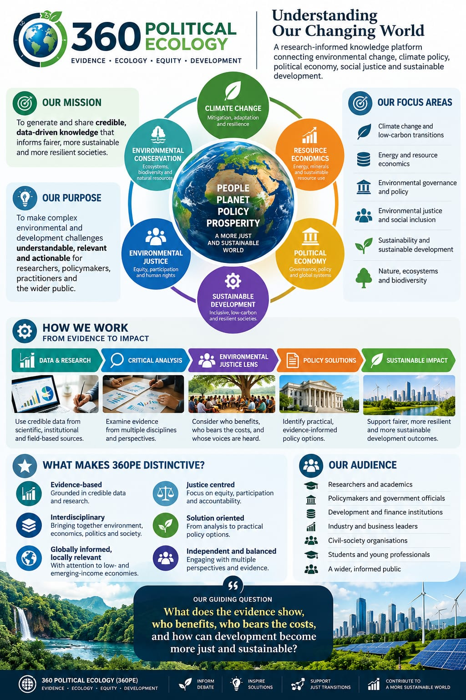

**360 Political Ecology (360PE)** is an independent, interdisciplinary, research-informed platform that examines how environmental change, economic systems, institutions and social equity shape sustainable development.

**Guiding principles:** Evidence · Ecology · Equity · Development.

## Our mission

To generate and share credible, evidence-informed knowledge that supports fairer, more sustainable and more resilient societies.

## Our purpose

To make complex environmental and development questions understandable, relevant and actionable for researchers, policymakers, practitioners, students and the wider public—without losing important scientific qualifications or uncertainty.

## What we study

360PE Review uses [ten official areas of analysis](topics.qmd), including climate change, energy and resource economics, critical minerals, environmental justice and health, environmental governance, ecosystems, sustainability, climate finance, Just Transition, and international environmental policy and law.

The six broad perspectives in the institutional overview graphic are **illustrative conceptual perspectives**, not a replacement for the ten official thematic categories.

## How we work

::: {.pe-home-grid}
::: {.pe-home-card}
### Evidence and research

Use traceable scientific, institutional and field-based sources; describe definitions, limitations and uncertainties.
:::
::: {.pe-home-card}
### Critical interdisciplinary analysis

Compare interpretations, incentives, institutional contexts and plausible alternatives.
:::
::: {.pe-home-card}
### Justice and distribution

Consider who benefits, who bears environmental and social costs, and who participates in decisions.
:::
::: {.pe-home-card}
### Policy dialogue

Discuss credible options, implementation constraints and potential—not presumed—development outcomes.
:::
:::

## What distinguishes 360PE

- **Evidence-based:** Sources and quantitative claims should be traceable and appropriately qualified.
- **Interdisciplinary:** Economic, ecological, political and social perspectives inform analysis.
- **Justice-centred:** Distributional effects and public participation are central questions.
- **Globally informed, locally relevant:** Analysis considers low- and emerging-income economies while remaining globally engaged.
- **Independent and balanced:** We engage with competing arguments rather than presenting advocacy as causal evidence.
- **Solution-oriented:** Analysis can inform policy discussion without claiming an intervention's effectiveness before it has been evaluated.

## Who we serve

Researchers and academics; policymakers and public agencies; development and finance institutions; civil-society organizations; business leaders; students and emerging professionals; and an interested wider public.

## 360PE at a glance

{width="100%" fig-alt="Long-form institutional infographic outlining 360 Political Ecology's mission and purpose; six illustrative conceptual perspectives; an evidence-to-policy communication process; distinctive values; intended audiences; and the overarching question of who benefits and who bears development costs."}

*Figure. Institutional overview of 360 Political Ecology (360PE). This is a public-communication infographic; its six broad perspectives should not be confused with the ten official areas of analysis. Source: 360PE, supplied institutional visual (2026).*

## Our guiding question

> What does the evidence show, who benefits, who bears the costs, and how can development become more just and sustainable?

## Founder, independence and editorial standards

360PE was founded by **Dr. Amanfo Smart Edward, PhD**. Institutional affiliations included in contributor profiles are for identification and do not imply institutional endorsement. 360PE Review is **not presented as a peer-reviewed academic journal**.

[Meet the founder](founder.qmd) · [Read our editorial standards](editorial-standards.qmd) · [Contact 360PE](contact.qmd)
