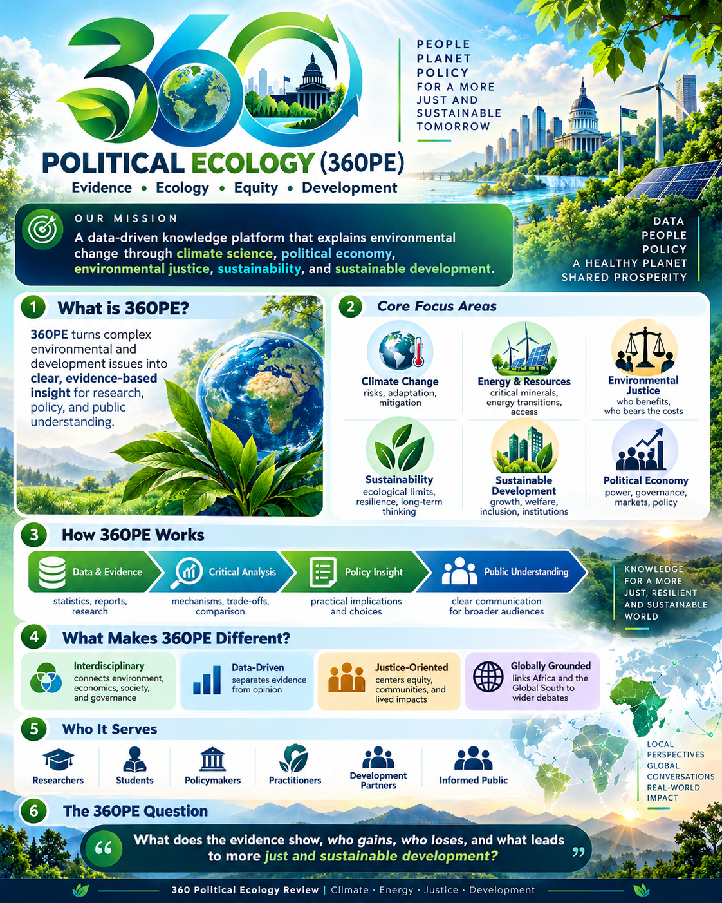

## Mission

360 Political Ecology is an independent, research-informed knowledge platform advancing understanding of environmental change through credible data, interdisciplinary analysis and critical policy evaluation.

**Evidence. Ecology. Equity. Development.**

360PE explores climate change, energy and resource economics, environmental justice, political economy, sustainability and sustainable development, including perspectives from low- and emerging-income economies.

## Founder and editor

**Amanfo Smart Edward, PhD** researches the intersections of environmental policy, energy economics, climate change and sustainable development.

## Editorial commitments

Distinguish established evidence from interpretation; disclose uncertainty; cite original sources; identify the date of each article; and correct substantive errors transparently.
