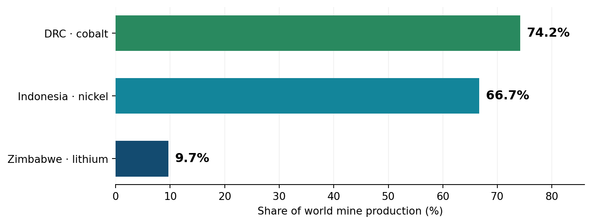

> **Advance online publication:** 10 October 2026. **Editorial update:** 13 October 2026 (source links and clarification of verification status). This comparative policy synthesis remains an advance edition; its final Issue 01 designation is pending completion of the remaining checks of USGS lithium and nickel tables. Any material corrections will be recorded in accordance with the [360PE Editorial Standards](../../editorial-standards.qmd).

[Download article PDF](article.pdf) · [Full evidence register](evidence-register.pdf)

Africa is increasingly central to the minerals powering electric vehicles, battery storage and industrial electrification. But the fact that a mineral is extracted domestically says little about where it is processed, who controls the resulting industries, or whether communities gain durable prosperity. As mineral-producing governments restrict exports in pursuit of higher-value production, a sharper question emerges: can control over ore become control over development?

The Democratic Republic of the Congo (DRC) has intervened in cobalt exports; Zimbabwe has tightened conditions on lithium exports. Indonesia supplies the revealing comparison. Its nickel-processing expansion shows that industrial activity can move onshore, but it also exposes the consequences of foreign ownership, coal-based energy and unstable commodity markets. The appropriate test is not processing volume alone: it is productive capability, public value capture, ecological integrity, environmental justice and resilience.

## The central findings

1 | Market position shapes bargaining power. The USGS estimates that the DRC supplied 74.2% of mined cobalt in 2025, Indonesia 66.7% of mined nickel and Zimbabwe approximately 9.7% of reported mined lithium. These are separate mineral markets, not interchangeable measures of influence.

2 | Processing growth is not a welfare metric. Indonesia’s processed-nickel output grew more than sixtyfold between 2014 and 2023, but the measure includes stainless-steel intermediates. Ownership, local linkages, fiscal returns and environmental burdens must be examined separately.

3 | A sustainable transition has local conditions. Processing mandates without reliable low-carbon electricity, enforceable labor and environmental standards, and shared decision-making can transfer pollution and financial risk to producing communities.

## Africa’s industrial-policy dilemma

The USGS Mineral Commodity Summaries 2026 (version 1.3) estimates 2025 mine production at 230,000 metric tons of cobalt content in the DRC, 28,000 metric tons of lithium content in Zimbabwe and 2.6 million metric tons of nickel content in Indonesia. Those figures establish a powerful contrast in resource-market positions, but they do not measure refining, battery-component manufacturing or national value added. In 2025 the DRC’s cobalt export suspension was replaced by a quota system; Zimbabwe’s subsequent 2026 export conditions must be understood separately from the USGS policy snapshot, which records measures available through late 2025.

**Table 1. Selected Mineral Producers: Mine Output, World Share, Reserves and Export Policies, 2025**

| Producer / mineral | 2025 mine output (t) | World share¹ | 2025 reserves (t) | Policy context |
| --- | --- | --- | --- | --- |
| DRC / cobalt | 230,000 | 74.2% | 6,000,000 | 2025 ban, then quotas |
| Indonesia / nickel | 2,600,000 | 66.7% | 62,000,000 | Nickel ore export ban |
| Zimbabwe / lithium | 28,000 | 9.7% | 500,000 | Lithium ore restrictions |
*Note. Metric tons are mineral content, not ore mass. ¹Author calculations using rounded USGS world totals: cobalt 310,000 t; nickel 3,900,000 t; lithium 290,000 t (world lithium total excludes withheld U.S. output). Different commodities and market structures cannot be compared as if they were the same market. Policy descriptions are simplified; Zimbabwe’s 2026 concentrate rules postdate the USGS late-2025 policy inventory.*  
*Source. USGS (2026), Mineral Commodity Summaries, pp. 16, 71, 119, 133; 2026 Zimbabwe policy detail: [Reuters (8 April 2026)](https://www.reuters.com/world/africa/zimbabwe-introduce-lithium-export-quotas-sets-conditions-resumption-shipments-2026-04-08/).*  

**Figure 1. Selected Producers’ Shares of World Mine Production, by Mineral, 2025**

*Note. Each bar describes a different mineral market. Shares derive from rounded estimates; values indicate mine production, not processing or pricing power. Lithium world total excludes undisclosed U.S. production.*  
*Source. Author calculations from USGS (2026), pp. 71, 119 and 133.*  

## Indonesia: what the nickel boom can—and cannot—prove

Indonesia required domestic ore processing under its 2009 Mining Law, prohibited nickel ore exports in 2014, relaxed some restrictions in 2017 and reinstated a full nickel ore ban in January 2020. According to British Geological Survey data presented by Our World in Data, processed-nickel production grew from approximately 22,000 tonnes in 2014 to more than 1.4 million tonnes in 2023. Its global share rose from about 1% to 41%. This striking outcome shows that processing shifted geographically during the policy period; it does not isolate the ban’s causal contribution from resource endowments, Chinese investment, industrial parks, infrastructure or energy costs.

Definitions also matter. The processed-nickel series counts intermediates such as nickel pig iron and ferronickel, much of which serves stainless-steel production. A narrower refined-nickel definition produces a different market share. The industrialization story is therefore broader than—and not equivalent to—domestic battery manufacturing.

### Who captures the value?

C4ADS traced corporate ownership for 19 refineries representing more than 90% of Indonesia’s 2023 capacity and concluded that Chinese companies or shareholders ultimately controlled at least 75% of that capacity. This is evidence about control of capacity, not a direct estimate of repatriated profits. To establish domestic value capture, policymakers need transparent information on profits, taxes, royalties, local procurement, worker earnings and reinvestment.

### Who carries the ecological and health burden?

In their 2024 assessment, CREA and CELIOS identified 10.8 GW of operational captive coal capacity in Indonesia in early 2024, with approximately 6.1 GW serving nickel processing. Their scenario-based pollution modeling projected at least 3,800 premature deaths annually in the near term, rising toward 5,000 annually by the end of the decade under the study’s assumptions. These are modeled future health impacts—not observed death counts—and should be read with assumptions and uncertainty in view. Still, the pathway is clear: processing powered by captive coal can transfer substantial climate and health burdens to local populations.

### Can production dominance outlast the commodity cycle?

USGS estimates a world nickel mine-production total of 3.9 million tons in 2025 and notes a primary nickel market surplus since 2022. The estimated annual average London Metal Exchange cash price fell from $21,495 per ton in 2023 to approximately $15,000 in 2025. The fall is not attributable to Indonesia alone, but it makes a central point: industrial scale can coexist with price volatility and financial exposure. Development strategies must therefore withstand weaker prices as well as expansionary booms.

## DRC and Zimbabwe: different bargaining positions

The DRC’s cobalt output constituted approximately three-quarters of world mine production in 2025. The country suspended cobalt exports in February 2025 and introduced a quota framework in October. USGS reports quotas of up to 96,600 tons of contained cobalt annually for 2026 and 2027, including 9,600 tons for strategic reserves. This illustrates an attempt to manage market supply and resource rents; it is not proof that export controls alone create domestic precursor, cathode or battery manufacturing.

Zimbabwe’s 2025 lithium output grew from an estimated 20,000 to 28,000 tons of lithium content, while its world share remained below 10%. Following a February 2026 suspension of lithium concentrate exports, [Reuters (8 April 2026)](https://www.reuters.com/world/africa/zimbabwe-introduce-lithium-export-quotas-sets-conditions-resumption-shipments-2026-04-08/) reported planned producer-specific export quotas, financial-disclosure obligations, labor, safety and environmental conditions, and commitments to establish lithium-sulphate facilities before January 2027. A 10% tax on concentrate exports was to continue ahead of a planned January 2027 ban on concentrate shipments. Such measures may encourage selected processing stages, but implementation, competitiveness and local benefits remain empirical questions. Mali’s estimated increase from 770 to 9,400 tons of lithium content between 2024 and 2025 further reinforces the need to assess emerging African suppliers and possibilities for regional coordination.

## The strongest objection—and what it gets right

Export restrictions can lower miners’ realized prices, discourage investment, encourage circumvention, invite trade disputes and leave facilities underused when demand changes. In an [April 2024 analysis](https://www.imf.org/en/news/articles/2024/04/29/cf-harnessing-sub-saharan-africas-critical-mineral-wealth), IMF economists Wenjie Chen, Athene Laws and Nico Valckx warned that inward-looking industrial policies may produce inefficiencies, distort markets and raise costs, while raw-material export bans can cause production to fall. These concerns deserve serious consideration, especially where electricity is unreliable, fiscal concessions are opaque or governments lack enforcement capacity. Conversely, doing nothing can leave processing concentrated in established international clusters. The appropriate policy choice is not a universal ban or an unconditional free-trade rule; it is a country- and mineral-specific comparison of feasible instruments and likely developmental returns.

## The 360PE development test: five questions that matter

Productive capability — Are local firms, technicians and institutions gaining transferable skills, supplier opportunities and technological know-how?

Public value capture — What portion of revenues, taxes, wages and reinvestment remains domestically, net of public subsidies?

Ecological integrity — How carbon-intensive are electricity and processing? What happens to local air, water, land, biodiversity and waste?

Environmental justice — Whose voices shape project decisions, who bears exposure and displacement, and who benefits across communities and generations?

Long-term resilience — Can infrastructure, firms and public budgets withstand commodity-price shocks, battery-chemistry changes and depletion?

## What policy should do differently

For dominant suppliers, quota and export-policy decisions should be assessed against transparent counterfactuals and accompanied by realistic industrial-investment plans. For smaller producers, time-bound incentives, negotiated processing milestones and regional specialization may be more credible than indefinite blanket restrictions. In every case, a credible development agreement should require public beneficial-ownership disclosure, independently monitored environmental and labor performance, reliable low-carbon power, meaningful community participation, and measurable local procurement and skills outcomes.

Regional cooperation matters because not every mineral-producing economy can efficiently reproduce every refining and manufacturing stage. African institutions can help harmonize standards and infrastructure planning, while competition policy, public participation and independent oversight help guard against resource enclaves.

## Conclusion | More processing is not yet more development

Indonesia’s nickel transformation demonstrates the scale of industrial change possible when an export restriction interacts with mineral endowments, capital, infrastructure and policy commitment. It simultaneously demonstrates why production growth, private ownership, emissions and community welfare must not be confused with one another. For African mineral producers, successful industrialization means creating capabilities and public value that remain after the boom—without consigning the ecological and health costs of global decarbonization to the communities supplying its minerals.

The essential question is not simply whether ore stays onshore. It is whether the transition leaves behind better institutions, cleaner infrastructure, stronger firms and fairer lives.

### For discussion

If a refinery is foreign-controlled and coal-powered but raises exports and employment, what additional evidence would persuade you that it constitutes sustainable development?

## Evidence and transparency

This article is an evidence-based comparative policy synthesis, not a causal impact evaluation of export bans. Production estimates come from the USGS 2026 report (version 1.3); processing volumes, ownership findings and health projections come from separate sources using different definitions and methods. Modeled harms are identified as projections. Mining shares measure extraction, not processing or profits. Reported 2026 policy changes may evolve; readers should consult the linked underlying sources for subsequent updates.

## Key sources and direct links

The following sources underpin major claims; the [evidence register](evidence-register.pdf) provides additional documentation. Links are provided for independent checking, not as a claim that every subsidiary statement has completed final fact-checking.

- [U.S. Geological Survey (2026), *Mineral Commodity Summaries 2026*](https://doi.org/10.3133/mcs2026) — mine production, reserves, market context and selected export controls (pp. 16, 71, 119 and 133).
- [Our World in Data, Indonesia's processed-nickel expansion](https://ourworldindata.org/data-insights/after-a-decade-of-growth-indonesia-has-become-the-worlds-largest-producer-of-processed-nickel) — historical processing volumes and definitions.
- [C4ADS, *Refining Power*](https://c4ads.org/commentary/refining-power/) — investigation of control over Indonesian refining capacity.
- [CELIOS and CREA, *Economic and Health Impact of Nickel Processing Industry*](https://celios.co.id/celios-x-crea-economic-and-health-impact-of-nickel-processing-industry/) — captive coal infrastructure and modeled health impacts.
- [International Energy Agency, *Global EV Outlook 2026*](https://www.iea.org/reports/global-ev-outlook-2026) — technology and battery-market context.
- [Reuters (8 April 2026), *Zimbabwe to introduce lithium export quotas, sets conditions for resumption of shipments*](https://www.reuters.com/world/africa/zimbabwe-introduce-lithium-export-quotas-sets-conditions-resumption-shipments-2026-04-08/) — conditional export resumption, quotas and processing commitments.
- [Chen, W., Laws, A., & Valckx, N. (29 April 2024), *Harnessing Sub-Saharan Africa’s Critical Mineral Wealth*, IMF](https://www.imf.org/en/news/articles/2024/04/29/cf-harnessing-sub-saharan-africas-critical-mineral-wealth) — benefits of regional processing strategies and risks of export bans.

*Editorial verification note (13 October 2026).* The cited April 2026 Reuters report and April 2024 IMF analysis have been checked against their original publications. The remaining reconciliation of selected USGS lithium and nickel figures and reserves against the relevant version 1.3 commodity tables is not complete; this advance edition should not be presented as fully fact-checked. The comparisons in Table 1 and Figure 1 describe **different commodities**, not equivalent industrial outcomes.

