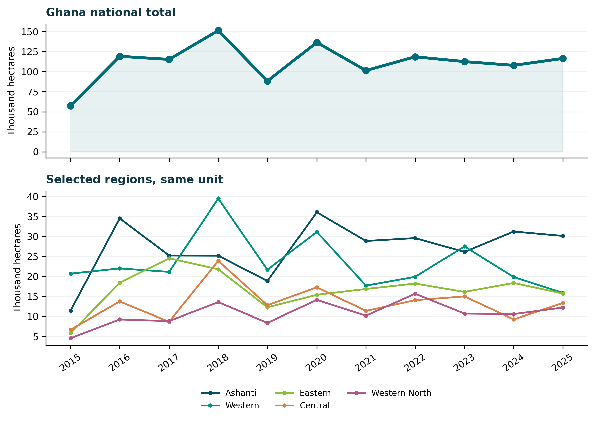
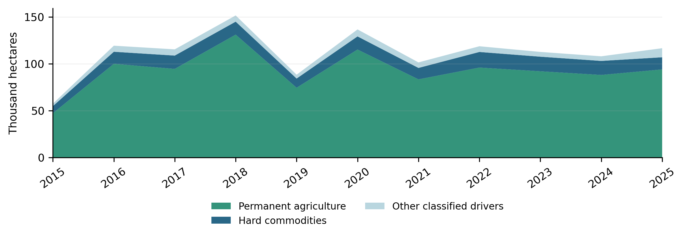

**360PE Review · Feature Analysis**  
**Article reference:** 360PE-2026-GHA-FORESTS

[Download the publication PDF](article.pdf) · [Browse 360PE Review](../../publications.qmd) · [Editorial standards](../../editorial-standards.qmd)

<h2>At a glance</h2><ul>
<li>Ghana recorded <strong>116,555 hectares</strong> of tree-cover loss at the 30% canopy threshold in 2025.</li>
<li>Permanent agriculture was the dominant mapped driver for roughly <strong>81%</strong> of that year's loss; these classifications do not establish the full causal chain.</li>
<li>Forest policy must be assessed alongside agricultural incentives, mining governance, land rights and rural livelihoods.</li>
</ul>

## The development question behind the missing trees

In Ghana, clearing a forest can be recorded as economic activity. A farm expands, a road opens, a mining operation produces revenue or a settlement gains space. The benefits may be real. But the same transaction can reduce carbon storage, fragment habitats, disturb watersheds, and shift costs onto communities that did not decide how the land would be used. The question is not whether rural people need opportunities. They do. It is whether the institutions that measure and reward development also account for what is being lost.

Newly examined Global Nature Watch data sharpen that question. At a 30% tree-canopy threshold, Ghana recorded <strong>116,555 hectares of tree-cover loss in 2025</strong>, compared with 101,414 hectares in 2021. The five years from 2021 through 2025 together account for about <strong>557,113 hectares</strong> of recorded loss. These are not net-deforestation estimates: the metric detects stand-replacing canopy disturbance, including some temporary changes, and does not subtract subsequent gains. Yet the persistence of substantial annual losses is difficult to dismiss as a statistical curiosity. [<a href="#ref-1" aria-label="Reference 1">1</a>]

The dashboard separately reports about <strong>93,000 hectares of natural-forest loss in 2025</strong>, associated with about 52 million tonnes of carbon dioxide emissions. The two figures measure different forest populations and must not be used interchangeably. Natural forest, tree cover and permanently converted forest land are not equivalent categories. The data reveal extensive pressure; they do not, on their own, tell us whether any particular policy caused, prevented, or failed to prevent an observed loss. [<a href="#ref-1" aria-label="Reference 1">1</a>, <a href="#ref-2" aria-label="Reference 2">2</a>]

Our central proposition is that forest outcomes cannot be understood through forestry policy alone. They emerge from land markets, agriculture, resource extraction, roads, administrative incentives, enforcement and the unequal capacity of people to influence decisions. If Ghana intends to protect forests while building prosperity, its environmental commitments must be evaluated against the development choices that determine land use.

## A decade of pressure, not a straight line

The 2015–2025 national series challenges a convenient storyline of uninterrupted acceleration. Annual tree-cover loss reached <strong>151,530 hectares in 2018</strong>, declined to 88,265 hectares in 2019, rose again to 136,613 hectares in 2020 and stood at 116,555 hectares in 2025. That last figure was about 8% higher than in 2024. The pattern is volatile, with no convincing sustained reduction across the most recent five-year period. Figure 1 shows the annual series; individual spikes justify investigation, not instantaneous explanations. [<a href="#ref-1" aria-label="Reference 1">1</a>]

The underlying Global Forest Change methodology changed over time and underreported Ghanaian loss before 2015. Global Nature Watch explicitly advises against treating observations from before and after that boundary as directly comparable. The principal figures here cover 2015–2025. The longer 2001–2025 record remains useful for describing cumulative mapped losses with suitable exceptions, not for drawing a seamless year-on-year trend across the methodological break. [<a href="#ref-1" aria-label="Reference 1">1</a>, <a href="#ref-2" aria-label="Reference 2">2</a>]

Spatial differences matter as much as the national total. In 2025, Ashanti recorded about <strong>30,171 hectares</strong> of tree-cover loss, Western 15,880, Eastern 15,706, Central 13,335, and Western North 12,195. Ashanti alone accounted for about 25.9% of Ghana's national total that year. The regional series also reveals changing positions: Western exceeded Ashanti in 2018 and 2023, while Ashanti reached its own 2015–2025 high of 36,116 hectares in 2020. Any claim that one region is always the worst performer would therefore be misleading. [<a href="#ref-1" aria-label="Reference 1">1</a>]

Area matters when comparing regions. During 2021–2025, Ashanti's cumulative loss was about <strong>9.6% of its mapped 2000 tree-cover extent</strong> at the same canopy threshold, compared with about 8.7% in Eastern, 7.5% in Western and 6.1% in Western North. These ratios contextualise gross loss; they are not measures of net decline, nor do they account for restoration. Regions with little baseline cover can also produce deceptively high percentages from small absolute changes. Our evaluation should use both absolute area and baseline-normalised loss. [<a href="#ref-1" aria-label="Reference 1">1</a>]

<figure id="figure-1" class="evidence-figure"><figcaption><strong>Figure 1. Annual tree-cover loss in Ghana and selected regions, 2015–2025</strong>Note. Tree-cover loss at &gt;30% canopy threshold; hectares converted to thousands. Series are descriptive, not causal. Source. Author calculations from       Global Nature Watch export (2026), country and subnational tables.</figcaption></figure>

## What the driver data say

Ghana's country-driver records challenge the tendency to explain forest loss primarily through whichever activity attracts the most immediate controversy. From 2001–2025, about <strong>1.55 million hectares</strong> of mapped tree-cover loss were attributed to permanent agriculture as the dominant driver, accounting for about 83% of the national total. <em>Hard commodities</em> accounted for about 214,000 hectares, or 11.4%; settlements and infrastructure accounted for roughly 65,000 hectares, or 3.5%. The remaining classifications include shifting cultivation, logging, wildfire and other natural disturbances. These are model-based dominant-driver assignments at about one-kilometre grid scale. They should not be presented as direct field verification for every location. [<a href="#ref-1" aria-label="Reference 1">1</a>]

More recent observations reinforce agriculture's importance. Across 2015–2025, the permanent-agriculture category accounts for about <strong>1.02 million hectares</strong> of loss. In 2025 alone, it accounts for about 93,910 hectares, or 80.6% of the national total. Hard commodities account for 12,958 hectares in that year. That means the driver composition is not merely a historical artefact from the early 2000s. Figure 2 follows the principal classifications yearly over the more comparable period. [<a href="#ref-1" aria-label="Reference 1">1</a>]

There are two qualifications. First, the <em>hard commodities</em> category includes mining <strong>and energy infrastructure</strong>; it is not a direct measure of all legal or illegal mining. Second, a dominant driver does not tell the whole causal story. Farms may expand because land tenure is insecure, yields are low, commodity prices fluctuate, roads improve access, or other land uses displace food production toward forest margins. Classifications identify the visible dominant land-use pressure, not the full political economy behind it. [<a href="#ref-1" aria-label="Reference 1">1</a>]

That distinction matters for public debate. Illegal mining can cause severe local damage to waterways and soils, even if agricultural conversion accounts for more hectares nationally. But a campaign that frames mining as the sole forest crisis risks overlooking the scale and structural nature of agricultural land conversion. A responsible policy response needs the right instrument for each pressure rather than a single villain.

<figure id="figure-2" class="evidence-figure"><figcaption><strong>Figure 2. Ghana tree-cover loss by dominant driver, 2015–2025</strong>Note. Dominant driver classifications at about 1 km scale; hard commodities include mining and energy infrastructure. Source. Author calculations from Global Nature Watch export (2026), Country drivers tab.</figcaption></figure>

## Cocoa, farming and the hidden displacement effect

Agriculture's prominence in the satellite classifications calls for more precise scrutiny, not a blanket indictment of farmers. Ghana's cocoa economy sustains many livelihoods and contributes to exports. Food production is equally indispensable. It would be unjust and economically simplistic to treat farmers as obstacles to conservation while leaving questions of prices, productivity, extension services, credit, tenure and market access unresolved.

A 2025 peer-reviewed analysis by Renier and colleagues examined direct and indirect forest conversion in Ghana's cocoa-growing tropical moist forest zone during 2000–2019. It attributed about <strong>57% of directly observed deforestation and degradation</strong> in that study area to cocoa, while identifying important contributions from food crops and logging. The researchers also traced indirect effects: expansion of one land use can displace food crops into forests elsewhere. This is a regional historical research result using a different definition than the countrywide Global Nature Watch driver series. It cannot be substituted for the national percentage of cocoa-driven loss in 2025. [<a href="#ref-3" aria-label="Reference 3">3</a>]

The result still exposes a policy blind spot. A cocoa plot may satisfy a narrowly defined traceability requirement while the broader food-and-land system continues to push conversion into less visible locations. Commodity-specific promises are necessary in many supply chains, but they are unlikely to be sufficient where land-use competition is systemic. The policy unit must be the landscape, not only the certified farm or export shipment.

For Ghana, this means combining credible forest protection with investment in productivity on existing farms; secure and intelligible land rights; agroforestry appropriate to local ecological conditions; and livelihood options that do not depend on indefinite frontier expansion. Each measure requires evaluation. Higher yields, for example, will not automatically spare forests if profitable farming induces further clearing. Land-use rules, incentives and tracking must work together.

## Mining's footprint and the limits of hectare accounting

Mining represents a different governance test. World Resources Institute research estimated about <strong>60,000 hectares of forest loss linked to mining in Ghana during 2001–2020</strong>, much associated with artisanal and small-scale gold mining. That estimate differs in period and method from Global Nature Watch's broader hard-commodities class and should not be added to it. The physical footprint of mining also fails to capture its full effects: sediment, contamination, damage to water systems, and impaired agricultural land can extend beyond the pixels classified as canopy loss. [<a href="#ref-4" aria-label="Reference 4">4</a>]

There is a serious counterargument to policies focused exclusively on prohibition. Artisanal mining can provide income where alternative employment is scarce, while aggressive enforcement without livelihood pathways may shift operations rather than resolve underlying incentives. Yet accepting livelihoods as important does not justify weak environmental standards, opaque concessions or irreversible degradation. Both propositions can be true.

An effective response would differentiate operations by legal status, ecological risk and capacity to meet standards; publish accessible concession and restoration information; protect critical watersheds; and tie rehabilitation requirements to enforceable financial assurances. Forest tracking should inform investigations, but remote-sensing alerts are not findings of individual criminal liability. Community participation and independent oversight are central to legitimacy.

## Forests as a climate asset and a warning signal

The climate dashboard illuminates a paradox. For the 2001–2025 accounting period, Ghana's mapped forests are estimated to have emitted an annual average of about <strong>43.55 million tonnes of CO</strong><strong>2</strong><strong>-equivalent</strong> while removing about <strong>53.81 million tonnes</strong> yearly, yielding an estimated <strong>net sink of 10.26 million tonnes per year</strong>. This does not contradict continuing forest loss. Remaining and regenerating woody vegetation can remove carbon, whereas disturbances release it elsewhere. Nor is this an official national inventory or proof that the land sector is meeting Ghana's climate targets. [<a href="#ref-1" aria-label="Reference 1">1</a>]

Forest carbon accounting also cannot exhaust the environmental value of a forest. A plantation may sequester carbon without restoring the biodiversity, hydrological functions, or cultural significance of an older native forest. But an area with modest tree cover may remain critical for savannah ecosystems and local livelihoods. Policies that optimise a single carbon number risk overlooking ecological integrity and environmental justice.

Ghana's documented 2021 updated nationally determined contribution includes the Cocoa Forest REDD+ Programme, trees on farms, forest conservation, plantation development and wildfire management. These are relevant interventions. However, the question of effectiveness requires programme-level evidence on implementation, finance, tracking, forest outcomes and counterfactual change. The Global Nature Watch time series is a useful independent diagnostic, not a substitute for this evaluation. [<a href="#ref-5" aria-label="Reference 5">5</a>, <a href="#ref-6" aria-label="Reference 6">6</a>]

## Commitments are multiplying. Is policy coherence keeping pace?

International commitments help define the ambition against which development choices should be examined. Article 5 of the Paris Agreement recognises the role of sinks and reservoirs and encourages forest-related action. The COP28 Global Stocktake reinforced the importance of halting and reversing deforestation and forest degradation by 2030, while calling for finance, technology and capacity support in sustainable development. This is an agreed policy direction, not a stand-alone finding that Ghana has breached a legal duty whenever a satellite is lost. [<a href="#ref-7" aria-label="Reference 7">7</a>]

The Kunming–Montreal Global Biodiversity Framework supplies an even more direct lens on cross-sector decisions. Target 1 emphasises biodiversity-inclusive spatial planning. Target 2 addresses restoration of degraded ecosystems. Target 10 focuses on sustainable agriculture and forestry. Target 14 calls for biodiversity considerations to be integrated into policies, planning and financial decisions. These are global targets; assessing Ghana requires attention to the national commitments and measures adopted to implement them. Ghana's National Biodiversity Strategy and Action Plan for 2026–2030 was recorded in the Convention on Biological Diversity's reporting system in October 2026, making its implementation agenda especially timely. [<a href="#ref-8" aria-label="Reference 8">8</a>, <a href="#ref-9" aria-label="Reference 9">9</a>]

At the national level, the Forestry Commission inaugurated a working group in May 2026 to develop a Forest Protection Strategy. Its announcement specifically noted forest offences and governance concerns affecting Ashanti and Western North, and emphasised coordination among agencies, enforcement, and community participation. Because the strategy was under development, the 2015–2025 trend cannot be used to judge its results. It can, however, tell the benchmarks against which future implementation should be examined. [<a href="#ref-10" aria-label="Reference 10">10</a>]

Ghana also advanced consultations in 2026 on an updated NDC for 2025–2035. The United Nations Development Programme described a validation process preceding Cabinet approval and submission. Until the final submission is verified, the proposed framework should not be conflated with the operative 2021 NDC submission. [<a href="#ref-13" aria-label="Reference 13">13</a>]

African institutions provide an essential additional frame. The African Union's Climate Change and Resilient Development Strategy and Action Plan (2022–2032) emphasises resilient development, inclusive governance, climate justice and African agency in defining development pathways. It reminds us that forest protection must be reconciled with poverty reduction, food security, and productive transformation, rather than imposed as a restriction disconnected from those goals. [<a href="#ref-11" aria-label="Reference 11">11</a>]

## Putting policy coherence to the test

The policy architecture is not empty. Ghana's Cocoa &amp; Forests Initiative commits participants to prevent further forest conversion for cocoa, strengthen traceability, and address risks to farmers. Its 2021 climate contribution includes forest-related programmes, while the Forestry Commission began developing a new Forest Protection Strategy in 2026. These commitments define what ought to be tested; they do not, by themselves, establish policy effectiveness or failure. [<a href="#ref-5" aria-label="Reference 5">5</a>, <a href="#ref-10" aria-label="Reference 10">10</a>, <a href="#ref-14" aria-label="Reference 14">14</a>]

<table class="policy-table"><caption>Table 1. From policy commitments to observable forest outcomes</caption><thead><tr><th scope="col">Policy arena</th><th scope="col">Policy commitment or process</th><th scope="col">Proposed implementation test</th></tr></thead><tbody><tr><td>Cocoa and farming</td><td>Cocoa &amp; Forests Initiative: forest-conversion commitments, farm traceability, and farmer safeguards.</td><td>Georeferenced farm conversion; displacement into other crops; livelihood and tenure outcomes.</td></tr><tr><td>Mining and forest protection</td><td>Forestry Commission's 2026 strategy-development process seeks stronger enforcement, licensing and coordination.</td><td>Concession footprints; verified forest-reserve disturbances; rehabilitation and watershed outcomes.</td></tr><tr><td>Climate and forest finance</td><td>2021 NDC and REDD+ architecture include cocoa forests, trees on farms, monitoring and safeguards.</td><td>Natural-forest condition, restoration survival, carbon estimates, benefit sharing and grievance outcomes.</td></tr><tr><td>Spatial planning and biodiversity</td><td>Global Biodiversity Framework Targets 1 and 14 call for integrated, biodiversity-inclusive planning.</td><td>Cross-sector spatial screening, documented alternatives, ecological risks and community participation.</td></tr></tbody></table>

Note. These are proposed evaluation questions, not an empirical policy scorecard. Sources. Ghana's updated NDC [<a href="#ref-5" aria-label="Reference 5">5</a>]; REDD+ profile [<a href="#ref-6" aria-label="Reference 6">6</a>]; Global Biodiversity Framework [<a href="#ref-8" aria-label="Reference 8">8</a>]; Forestry Commission [<a href="#ref-10" aria-label="Reference 10">10</a>]; Cocoa &amp; Forests Initiative [<a href="#ref-14" aria-label="Reference 14">14</a>].

<strong>The distributional test is equally important. </strong>Public records should reveal whose land-use claims were recognised, who received compensation or programme benefits, and who bore the costs of lost water quality, farm access or forest resources. Customary authorities, women farmers, forest-fringe communities and small-scale miners may face different constraints. Their perspectives should inform planning and independent review, rather than being treated as a substitute for measurable ecological outcomes.

## The strongest objection deserves an answer.

It would be easy to read continuing loss as conclusive evidence that Ghana's forest policies have failed. That inference would be too strong. We do not know from these data how much greater the loss might have been without specific interventions. Weather, global prices, land access, crop dynamics, and changes in detection methods and enforcement can all influence observed outcomes. Restoration benefits may also appear outside the loss indicator. A convincing impact evaluation requires comparison areas or other defensible counterfactual designs, implementation dates and independent verification.

There is also a danger of treating all agricultural expansion as avoidable. Population needs, food security and legitimate economic aspirations matter. The policy question is not whether productive land may ever be used differently; it is whether the decision process identifies high-value ecosystems, protects rights and secures durable public benefit. Restrictions that ignore local livelihoods can be unjust and difficult to enforce. Permissive conversion that ignores ecological costs can be equally unjust.

This is why the forest crisis should not be reduced to a contest between conservation and development. The harder task is to redesign the terms on which both are pursued. Evidence of concentrated loss calls for better targeting. Evidence of agricultural dominance calls for systems-level land-use reform. Evidence of environmental harm from mining calls for enforcement linked to credible economic alternatives.

## A practical policy test for the next decade

First, Ghana should make <em>landscape-level coherence</em> an explicit test for public investments and permissions. Forestry, agriculture, mining, roads, and district planning need shared spatial evidence and transparent procedures to identify conflicts. Decisions should document expected gains, ecological risks, affected rights and alternatives before conversion occurs. The biodiversity framework's integrated-planning ambitions provide a useful reference, but domestic implementation will determine the results. [<a href="#ref-8" aria-label="Reference 8">8</a>]

Second, policy should move beyond counting planted trees toward independently verifiable ecological outcomes. Reporting should distinguish intact natural forest, degraded forest, plantations and agroforestry; gross loss and net change; and carbon stocks from biodiversity and ecosystem services. Restoration priorities should consider ecological suitability and local rights rather than only headline hectare targets.

Third, the agricultural transition must be a forest policy. Investment in existing farming landscapes should combine extension and productivity improvements with tenure security, sustainable cocoa and food-crop systems, and credible limits on conversion in high-value ecosystems. Because land-use displacement can cross administrative boundaries, safeguards must address both direct and indirect change. [<a href="#ref-3" aria-label="Reference 3">3</a>]

Fourth, accountability must become observable. Ghana can publish recurring regional dashboards with annual losses, dominant drivers, enforcement outcomes, restoration survival and relevant land-use permissions. These should be independently scrutinised and interpreted with transparent methods. The 2026 Forest Protection Strategy process presents an opportunity to embed measurable milestones rather than rely on broad institutional aspirations. [<a href="#ref-10" aria-label="Reference 10">10</a>]

Finally, climate and biodiversity finance should reward durable outcomes without marginalising land-dependent communities. Benefit-sharing arrangements, common and statutory tenure, public access to contracts and grievance mechanisms deserve as much attention as carbon accounting. The UN Convention to Combat Desertification's land-degradation-neutrality framework and the African Union's climate strategy reinforce the importance of restoring productive landscapes and protecting development opportunities. [<a href="#ref-11" aria-label="Reference 11">11</a>, <a href="#ref-12" aria-label="Reference 12">12</a>]

## What should count as progress?

Ghana's forest-loss data do not tell us that every development decision is misguided. They tell us that substantial canopy disturbance continues alongside an expanding architecture of conservation commitments. The difficult question is whether institutions responsible for economic transformation and institutions responsible for ecological protection are operating toward a coherent national goal.

The answer should be measured not only in hectares kept or trees planted, but also in secure livelihoods, better land-use decisions, functioning ecosystems, transparent public benefits and reduced exposure to environmental harm. A credible development strategy should enable prosperity to improve without depleting ecological assets faster than they can be protected and restored.

<strong>For discussion:</strong> If permanent agriculture remains the dominant mapped driver of Ghana's tree-cover loss, which reforms should come first: enforceable land-use limits, agricultural incentives, tenure reform, transparent supply chains, or investment in rural alternatives? What evidence would persuade us that the chosen combination is working?

## Evidence and methodological transparency

This article is an evidence-based policy synthesis, not a causal impact evaluation. Global Nature Watch's tree-cover-loss data come from satellite observation and classify stand-replacing tree-cover disturbance; they do not measure net deforestation. The default baseline uses areas with over 30% tree canopy in 2000. Forest-driver classifications denote the dominant observed driver within about 1 km cells and may not reflect all underlying causes. A separate forest-carbon model produces carbon estimates and does not replace Ghana's official greenhouse gas inventory. Pre-2015 and post-2015 losses should not be directly compared as an uninterrupted annual series, as the methods changed. Regional baseline-normalised percentages are gross losses relative to 2000 mapped tree cover and do not account for regrowth. Rounded totals may differ slightly between national and subnational tables. [<a href="#ref-1" aria-label="Reference 1">1</a>, <a href="#ref-2" aria-label="Reference 2">2</a>]

<strong>Data availability and reproducibility. </strong>Figures 1 and 2 were calculated from the Global Nature Watch global statistics workbook downloaded 3 November 2026. The national series and first-level regional series use the &gt;30% canopy threshold. The 2021–2025 national total sums five annual loss values (557,113 ha); Ashanti's 2025 share is 30,171/116,555 (25.9%), and permanent agriculture's share is 93,910/116,555 (80.6%). Cumulative regional loss ratios use mapped 2000 tree-cover extent as the denominator. The underlying workbook and dashboard permit independent inspection; all ratios are descriptive, not estimates of net deforestation or policy effects. [<a href="#ref-1" aria-label="Reference 1">1</a>, <a href="#ref-2" aria-label="Reference 2">2</a>]

## Sources and direct links

<ol><li id="ref-1">Global Nature Watch / World Resources Institute. (2026). Global country statistics workbook: Ghana country and subnational tree-cover-loss, dominant-driver, primary-forest and forest-carbon series (2001–2025). Data downloaded 3 November 2026; calculations use the &gt;30% canopy threshold. <a href="https://globalnaturewatch.org/dashboards/country/GHA/?category=summary" target="_blank" rel="noopener noreferrer">View source at globalnaturewatch.org</a></li><li id="ref-2">Global Nature Watch. (2026). Ghana country dashboard: Forest extent, tree-cover loss, dominant drivers and methodological guidance. <a href="https://globalnaturewatch.org/dashboards/country/GHA/?category=summary" target="_blank" rel="noopener noreferrer">View source at globalnaturewatch.org</a></li><li id="ref-3">Renier, C., Addoah, T., Guye, V., Garrett, R., Van den Broeck, G., zu Ermgassen, E. K. H. J., &amp; Meyfroidt, P. (2025). Direct and indirect deforestation for cocoa in the tropical moist forests of Ghana. Environmental Research: Food Systems, 2(2), 025006. <a href="https://doi.org/10.1088/2976-601X/add01b" target="_blank" rel="noopener noreferrer">View source at doi.org</a></li><li id="ref-4">Stanimirova, R., Harris, N., Reytar, K., Wang, K., &amp; Barbanell, M. (23 October 2024). Mining is increasingly pushing into critical rainforests and protected areas. World Resources Institute. <a href="https://www.wri.org/insights/how-mining-impacts-forests" target="_blank" rel="noopener noreferrer">View source at www.wri.org</a></li><li id="ref-5">Government of Ghana / Ministry of Environment, Science, Technology and Innovation. (2021). Ghana's updated nationally determined contribution under the Paris Agreement (2020–2030). UNFCCC NDC Registry. <a href="https://unfccc.int/documents/497515" target="_blank" rel="noopener noreferrer">View source at unfccc.int</a></li><li id="ref-6">UNFCCC REDD+ Web Platform. (n.d.). Ghana: National REDD+ submissions, strategies, safeguards and forest reference levels. <a href="https://redd.unfccc.int/submissions/by-country/country_detail/gha.html" target="_blank" rel="noopener noreferrer">View source at redd.unfccc.int</a></li><li id="ref-7">UNFCCC. (2023). Outcome of the first global stocktake. Decision 1/CMA.5, paragraphs 33–34. FCCC/PA/CMA/2023/16/Add.1. <a href="https://unfccc.int/sites/default/files/resource/1_CMA.5.pdf" target="_blank" rel="noopener noreferrer">View source at unfccc.int</a></li><li id="ref-8">Convention on Biological Diversity. (2022). Kunming–Montreal Global Biodiversity Framework, Targets 1, 2, 10 and 14. <a href="https://www.cbd.int/gbf/targets" target="_blank" rel="noopener noreferrer">View source at www.cbd.int</a></li><li id="ref-9">Convention on Biological Diversity. (2026). Ghana's National Biodiversity Strategy and Action Plan (2026–2030). Online Reporting Tool, record 301553. <a href="https://ort.cbd.int/database/record?documentID=301553" target="_blank" rel="noopener noreferrer">View source at ort.cbd.int</a></li><li id="ref-10">Ghana Forestry Commission. (12 May 2026). Working group for Ghana's Forest Protection Strategy inaugurated. <a href="https://fc.gov.gh/working-group-for-ghanas-forest-protection-strategy-inaugurated/" target="_blank" rel="noopener noreferrer">View source at fc.gov.gh</a></li><li id="ref-11">African Union. (2022). African Union Climate Change and Resilient Development Strategy and Action Plan (2022–2032). <a href="https://au.int/sites/default/files/documents/42276-doc-CC_Strategy_and_Action_Plan_2022-2032_23_06_22_ENGLISH-compressed.pdf" target="_blank" rel="noopener noreferrer">View source at au.int</a></li><li id="ref-12">United Nations Convention to Combat Desertification. (n.d.). Ghana country overview and land degradation neutrality data. <a href="https://data.unccd.int/country-overview?country=GHA" target="_blank" rel="noopener noreferrer">View source at data.unccd.int</a></li><li id="ref-13">United Nations Development Programme Ghana. (4 June 2026). Ghana advances validation of its 2025 updated nationally determined contributions. <a href="https://www.undp.org/ghana/news/ghana-advances-validation-its-2025-updated-nationally-determined-contributions" target="_blank" rel="noopener noreferrer">View source at www.undp.org</a></li><li id="ref-14">Ghana Ministry of Lands and Natural Resources. (n.d.). Cocoa &amp; Forests Initiative: Joint Framework for Action and commitments. <a href="https://mlnr.gov.gh/project/cocoa-forests-initiative/" target="_blank" rel="noopener noreferrer">View source at mlnr.gov.gh</a></li></ol>
