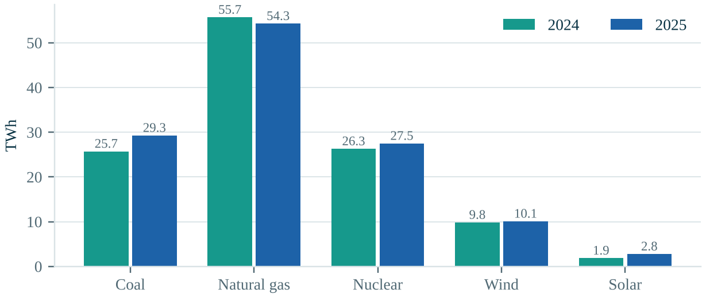
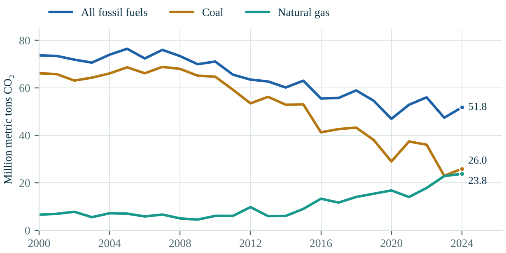
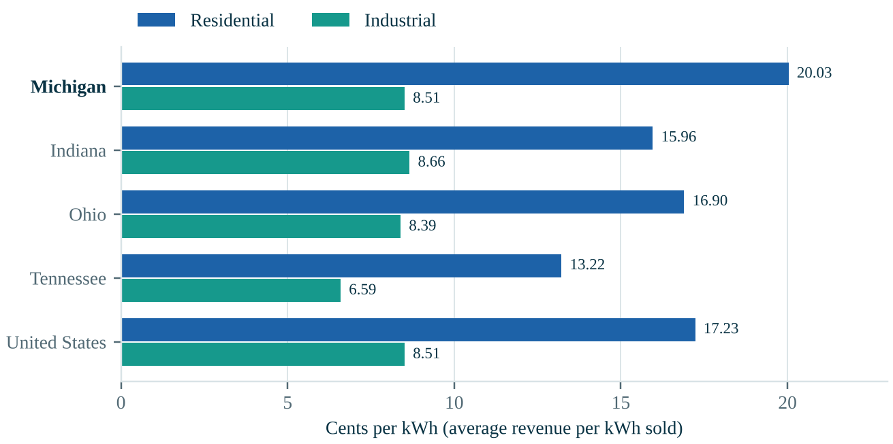
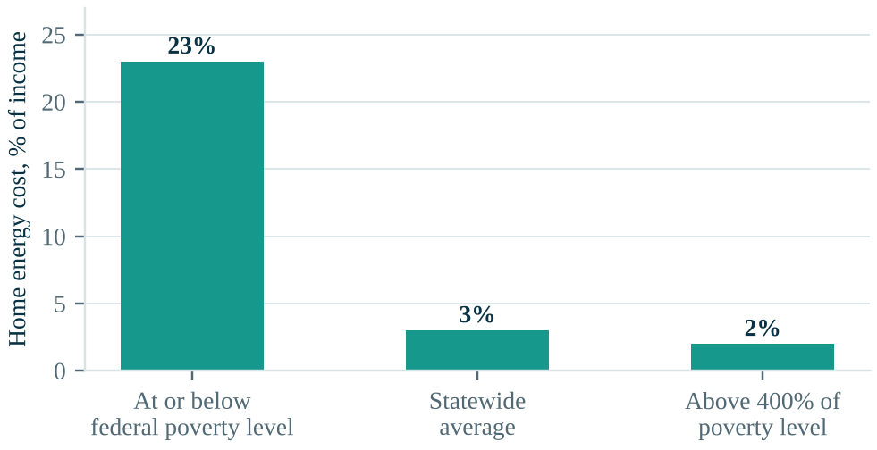
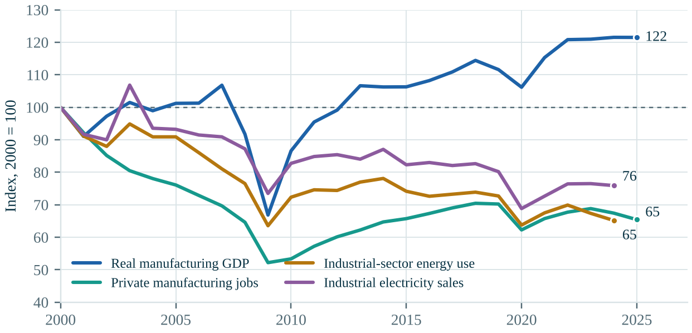
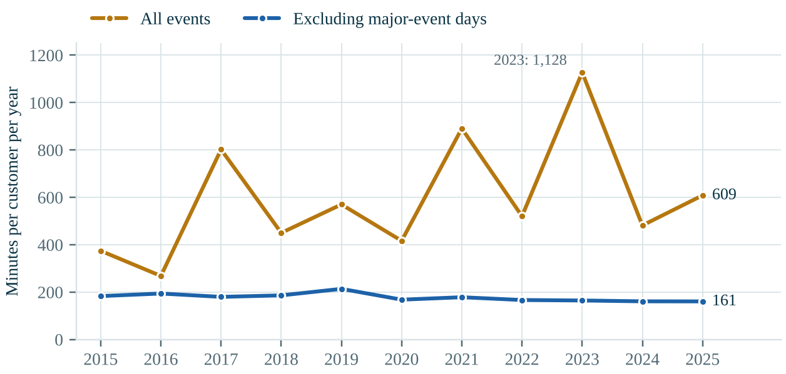

**360PE Review · Volume 03 · USA Edition · Feature Analysis**  
**Article reference:** 360PE-REV-2026-003

The $550 million solar development backed by General Motors reveals the opportunities and institutional contradictions at the heart of America’s industrial energy transition.

School of Business Administration, Andrews University, Berrien Springs, Michigan, USA · Founder, 360 Political Ecology (360PE)

[Download the publication PDF](article.pdf) · [Reference register (CSV)](evidence/reference-register.csv) · [Browse 360PE Review](../../publications.qmd) · [Editorial standards](../../editorial-standards.qmd)

## The next industrial revolution is also an energy revolution {#the-next-industrial-revolution-is-also-an-energy-revolution}

```{=html}
<p class="">Michigan helped define twentieth-century American industrial power. Automobile factories transformed production, urban landscapes and working-class livelihoods. The state’s industrial success depended on more than engineering and labor: it required an energy system capable of sustaining large-scale production. Today the challenge is to renew that productive base while changing the energy system on which it depends.</p>
```

```{=html}
<p class="">On November 12, 2026, General Motors (GM) announced its largest clean-energy project to date: two Michigan solar facilities developed by NorthStar Clean Energy, representing about $550 million in investment. Their combined 300 MW capacity and projected 539,000 MWh annual generation provide a concrete entry point into a much larger debate over American industrial development [<a href="#ref-1">1</a>].</p>
```

```{=html}
<p class="">The announcement arrives as manufacturers confront changing vehicle demand, digital infrastructure expands and policymakers face the simultaneous demands of decarbonization, reliability and affordability. The U.S. Energy Information Administration (EIA) projects nearly 4,390 TWh of electric-power-sector generation in 2026, 2.7% more than in 2025, followed by 1.2% growth in 2027. These are national forecasts, not Michigan-specific outcomes. Nevertheless, they still illustrate why the economics of electricity supply now matter to the location and competitiveness of industrial investment [<a href="#ref-2">2</a>].</p>
```

```{=html}
<p class="">This article argues that the decisive challenge is converting privately secured energy advantages into public development security. Michigan’s power-sector combustion CO<sub>2</sub> emissions have fallen substantially, yet its manufacturing employment has not recovered to pre-pandemic levels and low-income households bear exceptionally high energy burdens. Four investigations connect generation and emissions, industrial economics, grid planning and policy alignment; a place-based energy justice analysis asks who controls investment and captures its benefits. GM’s project is an entry point, not a causal test of industrial revival [<a href="#ref-3">3</a>, <a href="#ref-4">4</a>, <a href="#ref-5">5</a>].</p>
```

### Key findings {#key-findings}

```{=html}
<p class="">Michigan has achieved measurable power-sector CO<sub>2</sub> reductions while keeping substantial fossil generation. Real manufacturing value added and employment have diverged: output per job nearly doubled between 2000 and 2025, while inflation-adjusted average manufacturing pay remained below its 2000 level. Industrial electricity prices match the national average, but residential prices exceed it, and low-income energy burdens remain high. Proposed utility portfolios combine large additions of renewables and storage with new gas capacity. These tensions make the transition a question of institutional coordination and distribution, not merely technology selection [<a href="#ref-3">3</a>, <a href="#ref-5">5</a>, <a href="#ref-6">6</a>, <a href="#ref-7">7</a>, <a href="#ref-8">8</a>, <a href="#ref-9">9</a>, <a href="#ref-10">10</a>, <a href="#ref-39">39</a>].</p>
```

## 1. The project: what GM has actually secured {#1-the-project-what-gm-has-actually-secured}

```{=html}
<p class="">The Branch Solar facility in Branch County and Lake Iris Solar in St. Clair County connect rural generating landscapes to Michigan’s manufacturing economy. NorthStar Clean Energy developed the projects, and GM is the primary customer through a virtual power purchase agreement (VPPA). GM reports an allocation of 92% of combined capacity, while the projected total output of both facilities is 539,000 MWh. GM compares this total with the combined annual electricity use of Factory ZERO in Detroit-Hamtramck, Flint Assembly and Lansing Delta Township Assembly. The announcement does not disclose GM’s precise annual contracted MWh, hourly delivery profile or settlement price [<a href="#ref-1">1</a>].</p>
```

```{=html}
<div aria-label="Table 1" class="table-scroll" role="region" tabindex="0"><table id="table-1"><caption>Table 1. Project scale and contractual structure</caption><thead><tr><th scope="col">Indicator</th><th scope="col">Reported value</th></tr></thead><tbody><tr><td>Combined investment</td><td>$550 million</td></tr><tr><td>Installed capacity</td><td>300 MW</td></tr><tr><td>GM allocation</td><td>92% of capacity</td></tr><tr><td>Projected annual generation</td><td>539,000 MWh (both projects)</td></tr><tr><td>Developer/buyer</td><td>NorthStar Clean Energy / GM</td></tr><tr><td>Construction employment</td><td>More than 550 jobs</td></tr><tr><td>Community award</td><td>$1 million, Bethel Township</td></tr></tbody></table></div>
```

```{=html}
<p class="source">Source: Author’s compilation based on GM’s project announcement (Garber [<a href="#ref-1">1</a>]). Reported project investment comprises about $380 million at Branch Solar and $170 million at Lake Iris. It is not verified direct GM capital expenditure. Construction jobs are not permanent jobs.</p>
```

```{=html}
<p class="">The projects’ expected annual output of 0.539 TWh equals about 0.42% of Michigan’s 2025 utility-scale generation of 128.532 TWh. That is modest at statewide scale but material to the solar sector. At 300 MW, the projected generation implies an annual average output of 61.5 MW and a capacity factor of about 20.5%, assuming a non-leap year. These are energy-production metrics, not accredited reliability capacity or measured project performance [<a href="#ref-8">8</a>].</p>
```

### The geography of an industrial transition {#the-geography-of-an-industrial-transition}

```{=html}
<p class="">The two solar facilities add electricity to the grid rather than directly supplying the three factories through dedicated wires. The arrangement links rural land, regional transmission, utility service and urban manufacturing through both physical and contractual networks. Its economic significance depends on how those networks assign value and risk. Local communities host the infrastructure, while corporate purchasers receive contractual benefits and the grid receives electricity. A political ecology analysis must examine all three relationships [<a href="#ref-1">1</a>].</p>
```

```{=html}
<p class="">GM also reports it secured renewable energy sufficient to match annual electricity use across its U.S. facilities in 2025 and reduced operational Scope 1 and Scope 2 emissions by 52% since 2018. Both are company-level statements, not project-level verified avoided emissions. Neither shows that the three Michigan assembly plants receive solar electricity every hour or that the two projects alone caused the reported reduction [<a href="#ref-1">1</a>].</p>
```

## 2. Investigation I | Michigan’s historical energy transition {#2-investigation-i-michigan-s-historical-energy-transition}

```{=html}
<p class="">Michigan’s transition must be assessed through both the generation mix and observed emissions. EIA’s final 2025 tables provide a directly reproducible comparison with 2024, while its State Energy Data System (SEDS) supplies the longer emissions record. The archived 2015 electricity profile identifies coal as Michigan’s principal source, but the 2020 and 2024 profiles identify natural gas. This change establishes fuel substitution without relying on an unreconciled third-party historical generation series [<a href="#ref-3">3</a>, <a href="#ref-8">8</a>, <a href="#ref-11">11</a>, <a href="#ref-12">12</a>, <a href="#ref-13">13</a>].</p>
```

```{=html}
<figure id="figure-1"><figcaption>Figure 1. Michigan utility-scale electricity generation by fuel, 2024–2025 (TWh). Source: Author’s construction based on data from EIA, Electric Power Annual 2025, Tables 3.8, 3.11, 3.13, 3.18 and 3.21 [<a href="#ref-8">8</a>]. Values rounded; small-scale solar excluded; selected fuels do not sum to total generation.</figcaption></figure>
```

```{=html}
<div aria-label="Table 2" class="table-scroll" role="region" tabindex="0"><table id="table-2"><caption>Table 2. Michigan generation benchmarks from final EIA tables (TWh)</caption><thead><tr><th scope="col">Year</th><th scope="col">Coal</th><th scope="col">Gas</th><th scope="col">Nuclear</th><th scope="col">Wind</th><th scope="col">Solar</th></tr></thead><tbody><tr><td>2024</td><td>25.7</td><td>55.7</td><td>26.3</td><td>9.84</td><td>1.86</td></tr><tr><td>2025</td><td>29.3</td><td>54.3</td><td>27.5</td><td>10.1</td><td>2.79</td></tr></tbody></table></div>
```

```{=html}
<p class="source">Source: Author’s compilation based on data from EIA, Electric Power Annual 2025, Tables 3.8, 3.11, 3.13, 3.18 and 3.21 [<a href="#ref-8">8</a>]. Values rounded; selected sources do not sum to total generation.</p>
```

```{=html}
<p class="">EIA’s historical annual state-generation workbook provides a longer anchor: in 2000, Michigan generated approximately 68.27 TWh from coal and 12.61 TWh from natural gas, compared with 29.29 TWh and 54.29 TWh, respectively, in 2025. Thus, coal generation fell about 57.1%, while gas generation more than quadrupled. In 2025, coal and gas still accounted for approximately 65.0% of utility-scale generation. The distinction matters: fuel substitution can reduce combustion CO<sub>2</sub> intensity without eliminating fossil dependence. These are electricity-generation quantities, not SEDS fuel-consumption figures, and they cannot be substituted for one another [<a href="#ref-8">8</a>, <a href="#ref-14">14</a>].</p>
```

```{=html}
<p class="">The latest annual figures complicate a linear transition story. EIA reports coal generation of 29.291 TWh in 2025, up 13.8% from 25.738 TWh in 2024. Gas generation declined 2.6% to 54.287 TWh. Total utility-scale generation rose 3.5%, from 124.200 to 128.532 TWh. The data establish the rebound, not its cause: weather, fuel prices, outages and dispatch can all influence the observed mix [<a href="#ref-8">8</a>].</p>
```

```{=html}
<p class="">Michigan’s 2025 utility-scale solar photovoltaic generation reached 2.786 TWh, versus 1.859 TWh in 2024. The GM-associated projects’ projected 0.539 TWh is about 19.3% of that 2025 utility-scale solar benchmark. Small-scale solar adds a further 0.415 TWh in 2025, bringing the total estimated solar output to 3.201 TWh; the same project output accounts for about 16.8% of that wider benchmark. These are scale comparisons, not incremental market shares or observed 2026 production. The projects could materially expand Michigan’s solar sector while remaining modest relative to the entire grid [<a href="#ref-8">8</a>].</p>
```

### Measuring environmental progress, not just fuel substitution {#measuring-environmental-progress-not-just-fuel-substitution}

```{=html}
<p class="">SEDS records Michigan electric-power-sector fossil-fuel CO<sub>2</sub> emissions of 73.733 million metric tons in 2000, 76.495 in 2005, 71.109 in 2010, 63.038 in 2015, 46.964 in 2020 and 51.803 in 2024. Between 2010 and 2024, emissions declined by 27.1%. However, they increased by 9.2% between 2023 and 2024, rising from 47.451 million to 51.803 million metric tons. Coal emissions fell from 64.718 to 25.964 million tons over 2010–2024, while gas emissions rose from 6.097 to 23.762 million. Thus, substantial decarbonization and persistent dependence on fossil fuels coexist. The rebound also shows why a single endpoint cannot establish a durable trajectory [<a href="#ref-3">3</a>].</p>
```

```{=html}
<figure id="figure-2"><figcaption>Figure 2. Michigan electric-power-sector fossil-fuel CO<sub>2</sub> emissions by fuel, 2000–2024 (million metric tons). Source: Author’s construction based on data from EIA SEDS 2024F, Michigan CO<sub>2</sub> emissions by sector, series TEEIE (all fossil fuels), CLEIE (coal) and NNEIE (natural gas) [<a href="#ref-3">3</a>]. The sector covers NAICS 22 electricity and CHP plants; it excludes industrial CHP and interstate electricity flows.</figcaption></figure>
```

```{=html}
<p class="">The EIA state electricity profiles provide a complementary, consistently labeled set of generation and environmental benchmarks. Between 2015 and 2024, reported CO<sub>2</sub> intensity fell from 1,307 to 957 lb/MWh (26.8%), SO<sub>2</sub> emissions fell from 150,606 to 34,549 short tons (77.1%), and NO<sub>x</sub> from 67,695 to 46,259 short tons (31.7%). These are major environmental gains, not merely accounting changes. They do not account for changes in population exposure, which depend on plant location, dispersion, and other pollution sources. The 2025 Electric Power Annual (Table 9.5) reports 56.051 million metric tons of CO2, 33 thousand metric tons of SO2, and 43 thousand metric tons of NOx, all higher than its 2024 values (54.012 million, 31 thousand, and 42 thousand). Its totals include useful thermal output from CHP; no new electricity-only intensity is inferred from that numerator. The recent rebound justifies scrutiny rather than a claim of irreversible decarbonization [<a href="#ref-11">11</a>, <a href="#ref-13">13</a>, <a href="#ref-15">15</a>].</p>
```

```{=html}
<div aria-label="Table 3" class="table-scroll" role="region" tabindex="0"><table id="table-3"><caption>Table 3. Environmental benchmarks from EIA state electricity profiles</caption><thead><tr><th scope="col">Year</th><th scope="col">Generation (TWh)</th><th scope="col">CO<sub>2</sub> intensity (lb/MWh)</th><th scope="col">SO<sub>2</sub> (short tons)</th><th scope="col">NO<sub>x</sub> (short tons)</th></tr></thead><tbody><tr><td>2015</td><td>113.008</td><td>1,307</td><td>150,606</td><td>67,695</td></tr><tr><td>2020</td><td>106.625</td><td>1,097</td><td>44,831</td><td>64,440</td></tr><tr><td>2024</td><td>124.200</td><td>957</td><td>34,549</td><td>46,259</td></tr></tbody></table></div>
```

```{=html}
<p class="source">Source: Author’s compilation based on data from EIA Michigan Electricity Profiles 2015, 2020 and 2024, Table 1 [<a href="#ref-11">11</a>, <a href="#ref-12">12</a>, <a href="#ref-13">13</a>]. Archived publication vintages; reported intensity is used rather than recomputing from a different emissions scope.</p>
```

## 3. Investigation II | Industrial electricity economics {#3-investigation-ii-industrial-electricity-economics}

```{=html}
<p class="">Michigan competes with other states for investment in vehicles, batteries, and advanced manufacturing. Electricity prices are one input to location decisions, alongside workforce skills, supplier networks, transport, taxes and productivity. Indiana and Ohio provide nearby industrial benchmarks; Tennessee offers a Southern automotive comparison. EIA’s 2025 annual price data reveal a striking difference between Michigan’s industrial and household electricity prices [<a href="#ref-8">8</a>].</p>
```

```{=html}
<figure id="figure-3"><figcaption>Figure 3. Residential and industrial electricity prices, 2025 (cents per kWh). Source: Author’s construction based on data from EIA, Electric Power Annual 2025, Table 2.10 [<a href="#ref-8">8</a>]. Average revenue per kWh sold; not individual tariffs or bills.</figcaption></figure>
```

```{=html}
<div aria-label="Table 4" class="table-scroll" role="region" tabindex="0"><table id="table-4"><caption>Table 4. Electricity prices by customer class, 2025 (¢/kWh)</caption><thead><tr><th scope="col">Location</th><th scope="col">Residential</th><th scope="col">Commercial</th><th scope="col">Industrial</th></tr></thead><tbody><tr><td>Michigan</td><td>20.03</td><td>14.48</td><td>8.51</td></tr><tr><td>Indiana</td><td>15.96</td><td>13.70</td><td>8.66</td></tr><tr><td>Ohio</td><td>16.90</td><td>11.58</td><td>8.39</td></tr><tr><td>Tennessee</td><td>13.22</td><td>12.87</td><td>6.59</td></tr><tr><td>United States</td><td>17.23</td><td>13.37</td><td>8.51</td></tr></tbody></table></div>
```

```{=html}
<p class="source">Source: Author’s compilation based on data from EIA, Electric Power Annual 2025, Table 2.10 [<a href="#ref-8">8</a>]. Values are final annual sector averages.</p>
```

```{=html}
<p class="">Michigan’s industrial average of 8.51¢/kWh equals the U.S. average, slightly below Indiana and above Ohio. Tennessee’s 6.59¢/kWh is much lower: Michigan’s price is about 29% higher. At an illustrative annual load of 100 GWh, Michigan’s average implies $8.51 million in electricity expenditure, compared with $6.59 million in Tennessee—a $1.92 million difference. This is a scale illustration, not a comparison of negotiated plant tariffs. Michigan’s industrial price increased from 8.26¢ in 2024 to 8.51¢ in 2025, about 3.0%, compared with 4.7% nationally. A VPPA can reduce certain price risks, but the contract does not establish a lower delivered electricity price [<a href="#ref-8">8</a>].</p>
```

### Household affordability and energy burden {#household-affordability-and-energy-burden}

```{=html}
<p class="">Michigan’s residential average of 20.03¢/kWh is 16.3% above the U.S. average (17.23¢). For a household using an assumed 800 kWh per month, that gap amounts to $22.40 per month. Residential customers pay about 2.35 times the industrial average, but this does not indicate cross-subsidization: voltage, delivery costs, load profiles, and tariff structures differ. Energy burden is a household-income measure, not a unit-price measure; it includes actual home energy spending, including heating [<a href="#ref-5">5</a>, <a href="#ref-8">8</a>].</p>
```

```{=html}
<p class="">Michigan’s 2025 Healthy Climate Plan report provides the missing distributional evidence. Drawing on the Department of Energy’s Low-Income Energy Affordability Data (LEAD) Tool, the report identifies a statewide average home energy burden of 3%, but 23% among households at or below the federal poverty level. The corresponding figure is 2% for households above 400% of that threshold. Average annual energy costs for these two groups were $2,347 and $2,748, respectively. Thus, the households with lower average expenditure face a much greater relative burden [<a href="#ref-5">5</a>, <a href="#ref-16">16</a>].</p>
```

```{=html}
<figure id="figure-4"><figcaption>Figure 4. Average household home-energy burden by income group in Michigan (% of household income). Source: Author’s construction based on data from EGLE, MI Healthy Climate Plan: 2025 Report, p. 21, Figure 5 [<a href="#ref-5">5</a>], which draws on DOE’s LEAD Tool [<a href="#ref-16">16</a>]. The federal poverty level is the income benchmark. The report’s underlying data vintage is not equated with the 2025 EIA price series.</figcaption></figure>
```

```{=html}
<p class="">This gradient clarifies the political economy of electricity affordability. A large manufacturer can hedge some energy market risk; a low-income household may have little capacity to absorb higher heating and electricity costs. A clean industrial transition should evaluate not only average rates but also household burden, amounts unpaid, disconnections, and access to energy efficiency. Public policy must distinguish legitimate industrial cost advantages from cost shifting, and evaluate whether new large loads create shared system benefits.</p>
```

### Industrial output, jobs and the limits of a low-cost electricity strategy {#industrial-output-jobs-and-the-limits-of-a-low-cost-electricity-strategy}

```{=html}
<p class="">BEA and BLS releases permit a consistent, longer-run description of Michigan’s manufacturing transformation. In BEA’s SAGDP9 manufacturing series (September 30, 2026 revision), real value added increased from $84.67 billion in 2000 to $102.88 billion in 2025 (+21.5%; chained 2017 dollars). Over the same period, private manufacturing employment in the BLS Quarterly Census of Employment and Wages (QCEW) fell from 890,879 to 582,935 (−34.6%). Real value added per private payroll job rose from about $95,037 to $176,489 (+85.7%). This measure is an output-per-job ratio, not productivity per labor hour; differences in sectoral coverage, hours, industry composition and outsourcing limit causal interpretation [<a href="#ref-6">6</a>, <a href="#ref-7">7</a>].</p>
```

```{=html}
<figure id="figure-5"><figcaption>Figure 5. Michigan real manufacturing value added, private manufacturing employment, industrial-sector energy consumption and industrial electricity sales, indexed to 2000 = 100. Source: Author’s calculations based on data from BEA SAGDP9 [<a href="#ref-6">6</a>]; BLS QCEW, private manufacturing [<a href="#ref-7">7</a>]; EIA SEDS 2024F, series TEICB and ESICP [<a href="#ref-3">3</a>]. The energy and electricity series end in 2024 and cover the entire industrial sector, not manufacturing alone; the 2003 spike in electricity sales appears in the published SEDS series. BLS reconstructs the 2000 QCEW value from SIC-coded data.</figcaption></figure>
```

```{=html}
<p class="">The 2023–2025 comparison sharpens the diagnosis: QCEW private manufacturing employment declined from 613,227 to 582,935 (−4.9%), while real manufacturing value added rose from $102.42 billion to $102.88 billion (+0.5%). Average annual QCEW pay grew from $78,459 to $85,789 (+9.3%) in nominal dollars. These observations are not interchangeable with the Current Employment Statistics payroll series, and a rise in average wages does not show that gains were evenly shared across workers [<a href="#ref-6">6</a>, <a href="#ref-7">7</a>].</p>
```

```{=html}
<p class="">Adjusting for inflation changes the longer-run picture. Deflated by the U.S. Consumer Price Index for All Urban Consumers (CPI-U), average annual manufacturing pay in 2025 dollars fell from $93,292 in 2000 to $85,789 in 2025 (−8.0%), while consumer prices rose 87.0% and nominal pay rose 71.9%. Real pay rose 3.5% over 2023–2025 but remained 0.5% below its 2019 level. Set beside an 85.7% rise in real value added per job, this shows that measured output gains coexisted with a decline in average real pay over the full period. The comparison is descriptive: average pay is affected by workforce composition, and a national CPI-U may differ from Michigan-specific price change [<a href="#ref-7">7</a>, <a href="#ref-39">39</a>].</p>
```

### Energy use, carbon emissions and structural change: matched-period evidence {#energy-use-carbon-emissions-and-structural-change-matched-period-evidence}

```{=html}
<p class="">EIA SEDS industrial-sector energy consumption decreased from 954,987 billion Btu in 2000 to 622,445 billion Btu in 2024 (−34.8%). Industrial-sector fossil CO<sub>2</sub> emissions declined from 27.38 to 16.53 million metric tons (−39.6%). Over the matched 2000–2024 period, the broader industrial-energy/manufacturing-value-added proxy fell from 11.28 to 6.05 thousand Btu per chained 2017 dollar (−46.4%). The numerator includes non-manufacturing industrial activities, while the denominator is limited to manufacturing, so this ratio reflects changes in relative scale rather than observed manufacturing energy efficiency. Separately, industrial direct energy-related CO<sub>2</sub> per unit of reported industrial energy declined by about 7.4%, although boundary differences mean the measure should not be interpreted as a life-cycle emissions coefficient [<a href="#ref-3">3</a>, <a href="#ref-6">6</a>].</p>
```

```{=html}
<p class="">Electricity sold to Michigan’s industrial sector offers a narrower check. SEDS records 37,268 GWh in 2000 and 28,290 GWh in 2024 (−24.1%), a smaller decline than total industrial energy use, so electricity’s share of industrial energy rose from 13.3% to 15.5%. Industrial electricity per chained 2017 dollar of manufacturing value added fell from 0.44 to 0.27 kWh (−37.5%). This series still covers the whole industrial sector, including mining, construction and agriculture, and excludes on-site self-generation. EIA’s Manufacturing Energy Consumption Survey (MECS), a nationally representative sample survey of manufacturing establishments, publishes national and census-region estimates rather than individual state estimates. No comparable Michigan-specific manufacturing energy series was identified in the EIA datasets reviewed [<a href="#ref-3">3</a>, <a href="#ref-40">40</a>].</p>
```

```{=html}
<p class="">The findings are consistent with a long-term decoupling of some resource pressures from measured manufacturing value added. Still, they do not identify the causal contribution of electrification, cleaner production, fuel substitution, industrial relocation, offshoring or compositional change. A convincing claim of structural industrial decarbonization requires industry-matched accounts of energy, output, and emissions, ideally with manufacturing subsector decomposition. SEDS 2024F ends in 2024, so 2025 energy and CO<sub>2</sub> values are not yet available [<a href="#ref-3">3</a>].</p>
```

```{=html}
<div aria-label="Table 5" class="table-scroll" role="region" tabindex="0"><table id="table-5"><caption>Table 5. Michigan industrial development and energy indicators (selected benchmark years)</caption><thead><tr><th scope="col">Indicator</th><th scope="col">2000</th><th scope="col">2024</th><th scope="col">2025</th><th scope="col">Change*</th></tr></thead><tbody><tr><td>Real manufacturing GDP ($bn, chained 2017)</td><td>84.67</td><td>102.90</td><td>102.88</td><td>+21.5% (2000–25)</td></tr><tr><td>Private manufacturing jobs</td><td>890,879</td><td>600,753</td><td>582,935</td><td>−34.6% (2000–25)</td></tr><tr><td>Real value added per job ($)</td><td>95,037</td><td>171,284</td><td>176,489</td><td>+85.7% (2000–25)</td></tr><tr><td>Average annual pay, nominal ($)</td><td>49,900</td><td>82,422</td><td>85,789</td><td>+71.9% (2000–25)</td></tr><tr><td>Average annual pay, 2025 dollars (CPI-U)</td><td>93,292</td><td>84,591</td><td>85,789</td><td>−8.0% (2000–25)</td></tr><tr><td>Industrial energy (billion Btu)</td><td>954,987</td><td>622,445</td><td>n.a.</td><td>−34.8% (2000–24)</td></tr><tr><td>Industrial electricity sales (GWh)</td><td>37,268</td><td>28,290</td><td>n.a.</td><td>−24.1% (2000–24)</td></tr><tr><td>Industrial-sector CO<sub>2</sub> (million t)</td><td>27.38</td><td>16.53</td><td>n.a.</td><td>−39.6% (2000–24)</td></tr></tbody></table></div>
```

```{=html}
<p class="source">*Change uses the period indicated; n.a. = not available. Cross-sector ratios are proxy indicators only. Source: Author’s calculations based on data from BEA SAGDP9 [<a href="#ref-6">6</a>], BLS QCEW private manufacturing [<a href="#ref-7">7</a>], BLS CPI-U [<a href="#ref-39">39</a>] and EIA SEDS 2024F [<a href="#ref-3">3</a>].</p>
```

```{=html}
<p class="">Because BLS reconstructs the 2000 NAICS manufacturing figures from SIC-classified data, Table 6 repeats the main comparisons from a 2001 baseline, the first year of native NAICS coding. The direction of every result is unchanged. The output gain is larger since 2001 because that recession year depressed manufacturing value added; declines in jobs, energy, electricity, and emissions are smaller but still substantial, and real pay remains below its starting level.</p>
```

```{=html}
<div aria-label="Table 6" class="table-scroll" role="region" tabindex="0"><table id="table-6"><caption>Table 6. Robustness check: changes from a 2000 versus a 2001 baseline</caption><thead><tr><th scope="col">Indicator (end year)</th><th scope="col">From 2000</th><th scope="col">From 2001</th></tr></thead><tbody><tr><td>Real manufacturing GDP (2025)</td><td>+21.5%</td><td>+33.5%</td></tr><tr><td>Private manufacturing jobs (2025)</td><td>−34.6%</td><td>−29.0%</td></tr><tr><td>Real value added per job (2025)</td><td>+85.7%</td><td>+88.0%</td></tr><tr><td>Average annual pay, 2025 dollars (2025)</td><td>−8.0%</td><td>−5.0%</td></tr><tr><td>Industrial energy consumption (2024)</td><td>−34.8%</td><td>−28.5%</td></tr><tr><td>Industrial electricity sales (2024)</td><td>−24.1%</td><td>−17.2%</td></tr><tr><td>Industrial-sector CO<sub>2</sub> (2024)</td><td>−39.6%</td><td>−34.8%</td></tr></tbody></table></div>
```

```{=html}
<p class="source">Source: Author’s calculations based on data from BEA SAGDP9 [<a href="#ref-6">6</a>], BLS QCEW [<a href="#ref-7">7</a>], BLS CPI-U [<a href="#ref-39">39</a>] and EIA SEDS 2024F [<a href="#ref-3">3</a>]. The 2000 QCEW value comes from the BLS NAICS-based annual file for 2000, reconstructed from SIC data; from 2001 onward, the data are natively NAICS-coded.</p>
```

## 4. Finance | What a virtual power purchase agreement changes {#4-finance-what-a-virtual-power-purchase-agreement-changes}

```{=html}
<p class="">A VPPA separates physical electricity delivery from contractual price settlement and renewable energy attributes. NorthStar sells generation into the electricity market; GM continues purchasing electricity for its factories through existing supply arrangements. A typical financial PPA settles the difference between an agreed strike price and a reference wholesale price, and may transfer renewable energy certificates (RECs) to the buyer [<a href="#ref-1">1</a>, <a href="#ref-17">17</a>].</p>
```

```{=html}
<p class="">For a hypothetical $50/MWh strike price and a $65/MWh market price, the developer pays the buyer $15/MWh; at a $35/MWh market price, the buyer pays the developer $15/MWh. The developer’s simplified net revenue is $50/MWh before other adjustments. The manufacturer still pays its regular electricity bill. This arrangement can reduce certain market-price risks while introducing others, including basis risk between settlement and retail prices, hourly output risk, counterparty exposure and curtailment.</p>
```

### A financial instrument, not a guarantee of cheap electricity {#a-financial-instrument-not-a-guarantee-of-cheap-electricity}

```{=html}
<p class="">The creditworthiness of a major corporate purchaser can help make renewable projects financeable. Yet the financial benefit to GM cannot be calculated solely from announced investment and generation. Contract duration, strike price, reference hub, settlement volume, collateral, delivery provisions and REC terms remain necessary inputs. Larger corporations have more access to such contractual instruments than households or small firms, suggesting a potential inequality in the ability to manage energy uncertainty.</p>
```

### Corporate accounting versus physical decarbonization {#corporate-accounting-versus-physical-decarbonization}

```{=html}
<p class="">Scope 1 emissions arise from direct operations; Scope 2 emissions result from purchased energy. Eligible RECs can support market-based Scope 2 reporting if ownership and retirement requirements are satisfied. Annual matching, however, does not guarantee that electricity used at night or during low solar output is carbon-free. The GHG Protocol’s location-based and market-based approaches illuminate different parts of emissions responsibility [<a href="#ref-18">18</a>].</p>
```

```{=html}
<p class="">Three tests should govern the assessment: accounting integrity, physical additionality and temporal/spatial alignment. First, are certificates tracked and retired without double counting? Second, did the agreement enable additional clean generation, and what fossil generation is displaced? Third, does clean supply coincide with industrial demand and regional constraints? The project’s new facilities suggest a plausible physical contribution, but a credible additionality counterfactual and hourly dispatch data are still needed.</p>
```

```{=html}
<p class="">Average statewide carbon intensity cannot be used to establish avoided emissions. The proper counterfactual is time- and location-specific: what generation would have supplied the grid without the project? An avoided-emissions study would combine hourly project output with regional marginal emission factors or a dispatch model, check curtailment and interregional flows, and report uncertainty. EPA’s AVERT model offers a starting point for regional screening. Without those inputs, the article does not turn projected annual MWh into a claimed project-specific carbon reduction [<a href="#ref-19">19</a>].</p>
```

### The distribution of financial capacity {#the-distribution-of-financial-capacity}

```{=html}
<p class="">A practical policy implication is to expand access to risk-management mechanisms through aggregated purchasing for smaller firms, transparent procurement and well-designed utility programs. Such arrangements should remain subject to cost-of-service scrutiny. Financial innovation is most useful when it creates additional productive capacity and reduces uncertainty without transferring unpriced risks to others.</p>
```

## 5. Investigation III | Reliability and regional markets {#5-investigation-iii-reliability-and-regional-markets}

```{=html}
<p class="">Michigan’s factories are embedded in interconnected electricity markets, including the Midcontinent Independent System Operator (MISO) and, in parts of the state, PJM. A state can generate more electricity annually than it consumes, yet still experience local transmission constraints or periods of insufficient available capacity. Reliability is an hourly and spatial problem, not simply an annual energy balance.</p>
```

```{=html}
<p class="">MISO’s April 2026 planning resource auction indicated sufficient regional, subregional and zonal capacity for June 2026–May 2027. Its October 28 winter assessment reported about 134.7 GW of secured capacity offers against 113.4 GW of forecast peak demand. The arithmetic difference is 21.3 GW, but it is not an official planning reserve margin or a Michigan-specific surplus. Regional adequacy does not show that transmission and distribution systems can deliver uninterrupted electricity to every customer [<a href="#ref-20">20</a>, <a href="#ref-21">21</a>].</p>
```

```{=html}
<p class="">The regional auction also reveals the seasonal value of dependable capacity. In Local Resource Zone 7, which includes Michigan’s Lower Peninsula within MISO, the summer 2026 clearing price was $424.30 per MW-day; fall, winter and spring prices were $33.92, $35.97 and $7.61, respectively. The corrected May 22 auction results show 21,403.4 MW of committed seasonal accredited capacity in Zone 7 and 398.8 MW of summer imports, together matching the 21,802.2 MW final planning reserve requirement. This is a capacity-market result, not the wholesale energy price paid per MWh. The steep summer price highlights the value of capacity available at system stress, even where the planning requirement is met [<a href="#ref-20">20</a>].</p>
```

```{=html}
<p class="">Local reliability presents a separate challenge. Michigan’s regulator reports that outage duration under ordinary conditions improved by roughly 53 minutes per customer between 2019 and 2024. Yet its outage history records an initial report of 492,000 DTE outages in the July 23, 2026 event. These are different metrics—a long-run reliability measure and a particular event count—and should not be compared as though they measured the same thing. Adequate regional generation cannot substitute for resilient local networks, vegetation management, distribution investment and restoration capability [<a href="#ref-22">22</a>, <a href="#ref-23">23</a>].</p>
```

### The economics of seasonal adequacy {#the-economics-of-seasonal-adequacy}

```{=html}
<p class="">MISO’s capacity auction values reliability commitments, but its energy market pays for dispatched MWh and ancillary services that support balancing. Accreditation, transmission limits, demand assumptions and auction rules jointly affect clearing prices. Retail tariffs translate these costs through utility procurement and regulation, not a one-for-one conversion. Distribution reliability is a separate outcome. EIA’s IEEE-method state statistics report Michigan SAIDI of 608.6 minutes in 2025, versus 481.7 minutes in 2024; excluding major-event days yields SAIDI values of 161.0 and 161.3 minutes. In 2025, the ordinary SAIFI was 1.038 interruptions per customer, and the CAIDI was 155.1 minutes per interruption. The 2025 all-event SAIDI exceeded Indiana (379.0) and Ohio (205.5); excluding major events, Michigan still recorded 161.0 minutes, compared with 120.8 and 130.1. These comparisons cover reporting utilities, not every individual plant; Michigan’s IEEE reporting coverage was 94.4% of customers. The pattern suggests persistent local reliability challenges alongside extreme-event volatility, rather than a regional capacity shortage [<a href="#ref-24">24</a>, <a href="#ref-25">25</a>].</p>
```

```{=html}
<figure id="figure-6"><figcaption>Figure 6. Michigan distribution outage duration (SAIDI), 2015–2025 (minutes per customer per year). Source: Author’s construction based on data from EIA, Electric Power Annual 2025, Table 11.4, IEEE method [<a href="#ref-25">25</a>]. Major-event days are excluded in the second series; reporting coverage varies by year.</figcaption></figure>
```

### Capacity is not generation, and generation is not reliability. {#capacity-is-not-generation-and-generation-is-not-reliability}

```{=html}
<p class="">GM’s 300 MW solar portfolio is expected to average 61.5 MW over a year. The capacity that the regional system can credit for reliability depends on seasonal resource performance and contribution during system stress. It cannot be inferred from the annual capacity factor. Solar can displace daytime fuel consumption and diversify supply; storage, transmission, demand response and firm generation can address other system requirements [<a href="#ref-1">1</a>].</p>
```

### Palisades and the importance of firm low-carbon resources {#palisades-and-the-importance-of-firm-low-carbon-resources}

```{=html}
<p class="">The approximately 800-MW Palisades nuclear facility in Covert Township stopped generating in May 2022. NRC’s facility record describes the licensing, inspection and safety requirements for restarting the plant. Reporting on November 9, 2026, indicated that the restart date remained uncertain following additional work; no completed commercial restart is established in the sources reviewed. A successful restart could restore a major firm low-carbon resource. At an assumed 90% annual capacity factor, 800 MW would produce 6.31 TWh yearly, about 12 times the solar projects’ projected output. The scenario illustrates scale, not cost-effectiveness; restart costs, safety, outages, waste and flexibility also matter [<a href="#ref-26">26</a>, <a href="#ref-27">27</a>].</p>
```

```{=html}
<div aria-label="Table 7" class="table-scroll" role="region" tabindex="0"><table id="table-7"><caption>Table 7. Complementary generation scenarios</caption><thead><tr><th scope="col">Measure</th><th scope="col">GM solar projects</th><th scope="col">Palisades scenario</th></tr></thead><tbody><tr><td>Capacity</td><td>300 MW</td><td>800 MW</td></tr><tr><td>Annual capacity factor</td><td>20.5% implied</td><td>90% assumed</td></tr><tr><td>Annual generation</td><td>0.539 TWh projected</td><td>6.31 TWh simulated</td></tr><tr><td>Reliability role</td><td>Variable generation</td><td>Firm generation, subject to outages</td></tr></tbody></table></div>
```

```{=html}
<p class="source">Source: Author’s calculations based on Garber [<a href="#ref-1">1</a>] and NRC [<a href="#ref-26">26</a>]. Nuclear generation is conditional and hypothetical, not measured or forecast output.</p>
```

```{=html}
<p class="">The proper metric is system value: energy, dependable capacity, flexibility and transmission access relative to total cost and emissions. A portfolio of solar, wind, nuclear, storage, demand response and appropriate dispatchable resources may serve Michigan better than a technology rivalry. Planning must consider regional load growth, resource accreditation, and the actual delivery constraints faced by industrial sites.</p>
```

### The actual investment choices: DTE and Consumers Energy {#the-actual-investment-choices-dte-and-consumers-energy}

```{=html}
<p class="">DTE’s September 2026 proposed integrated resource plan lists 15 GW of renewable energy, 4.5 GW of storage, 2.2 GW of gas plants and 3 GW of coal retirements. Consumers Energy’s September 3 proposal (MPSC U-22127) describes over 19 GW of solar, wind and storage by 2040, two fast-start gas plants totaling 1.4 GW, and a new long-term Midland Cogeneration Venture purchase agreement. These are company proposals subject to regulatory review, not approved or operational resources; their headline totals use different categories and cannot simply be added. Both plans reinforce the importance of portfolio complementarity, but also reveal the tension between short-run adequacy and long-lived gas investment [<a href="#ref-9">9</a>, <a href="#ref-10">10</a>].</p>
```

```{=html}
<p class="">Regulatory scrutiny should compare alternative portfolios under high and low industrial/data-center demand, delayed interconnections, fuel-price shocks and slower storage deployment. New gas plants may provide dependable flexibility yet create fuel and emissions exposure, stranded-cost risk or a need for costly early retirement if clean-energy requirements tighten. Storage power in MW must be paired with duration in MWh; four-hour storage cannot automatically replace multi-day firm supply. The decisive question is whether the proposed portfolios meet reliability and clean-energy obligations at lowest risk-adjusted total system cost, with transparent allocation of costs among customers.</p>
```

## 6. Investigation IV | Federal–state political economy {#6-investigation-iv-federal-state-political-economy}

```{=html}
<p class="">Michigan’s transition involves institutions operating on different time horizons, including the Michigan Public Service Commission (MPSC). Under Public Act 235 of 2023, the general renewable portfolio requirement is 15% through 2029, 50% in 2030–2034, and 60% from 2035 onward. The clean-energy requirement is 80% in 2035–2039 and 100% from 2040. These are electricity-provider portfolio requirements, subject to statutory provisions and exceptions, rather than percentages of in-state physical generation. Eligible clean-energy resources include nuclear generation [<a href="#ref-28">28</a>, <a href="#ref-29">29</a>].</p>
```

```{=html}
<p class="">Federal law changed after the Inflation Reduction Act of 2022. Public Law 119-21, enacted July 4, 2025, accelerated termination of several incentives. Under the new rules and IRS Notice 2025-42, applicable wind and solar facilities that begin construction after July 4, 2026, generally must be placed in service by December 31, 2027, to remain eligible for the relevant Sections 45Y and 48E credits, subject to statutory rules and exceptions. Federal clean-vehicle acquisition credits generally stopped for vehicles acquired after September 30, 2025; the residential clean-energy credit stopped for expenditures after December 31, 2025 [<a href="#ref-30">30</a>, <a href="#ref-31">31</a>].</p>
```

### Institutional time-horizon mismatch {#institutional-time-horizon-mismatch}

```{=html}
<p class="">State clean-energy obligations extend well beyond federal wind and solar incentive deadlines. This mismatch can accelerate near-term investment and complicate financing of later projects. It does not prove that future electricity costs must rise: technological learning, competition, eligible alternative technologies, and financing innovation may offset the loss of support. Corporate offtake commitments can provide continuity, but private contracts cannot resolve every regulatory uncertainty.</p>
```

### Financing sensitivity: a transparent scenario {#financing-sensitivity-a-transparent-scenario}

```{=html}
<p class="">A simplified levelized cost model uses $550 million investment and 539,000 MWh annual generation as reported project anchors. With a 30-year life, a 7% discount rate, $8 million in annual operating costs, and constant generation, the annualized capital cost is calculated using the capital recovery factor r(1+r)n/[(1+r)^n-1]. An assumed effective capital support of 30% reduces upfront cost from $550 million to $385 million [<a href="#ref-1">1</a>].</p>
```

```{=html}
<div aria-label="Table 8" class="table-scroll" role="region" tabindex="0"><table id="table-8"><caption>Table 8. Illustrative generation cost sensitivity</caption><thead><tr><th scope="col">Scenario</th><th scope="col">Annualised cost per MWh</th></tr></thead><tbody><tr><td>No effective capital support</td><td>$97.07</td></tr><tr><td>30% effective capital support</td><td>$72.40</td></tr></tbody></table></div>
```

```{=html}
<p class="source">Source: Author’s calculations based on reported project anchors (Garber [<a href="#ref-1">1</a>]). Assumptions are hypothetical, not actual tax eligibility, VPPA price or developer return. Excludes degradation, detailed taxes, debt structure, inflation and integration costs.</p>
```

```{=html}
<p class="">Financing sensitivity extends the base case: at 5%, 7%, and 9% discount rates, illustrative generation costs without capital support are $81.22, $97.07, and $114.17/MWh, respectively; with 30% effective capital support, they are approximately $61.31, $72.40, and $84.37/MWh. A lower or higher annual output changes these estimates inversely. These are scenarios for an identical hypothetical project, not forecasts of future project bids or a claim that NorthStar received a particular tax credit. A demand shortfall can reduce utility revenue and expose remaining customers to fixed-cost recovery; long-term minimum-payment and exit protections can limit that risk but cannot eliminate forecast uncertainty. A strong planning comparison must jointly test financing, demand, and delivered system costs.</p>
```

```{=html}
<p class="">The federal regime also affects vehicle demand and production costs. In its Form 10-Q for the quarter ended September 30, 2026, GM estimated that tariffs could affect full-year 2026 adjusted EBIT by $2.5–$3.5 billion under then-current policy conditions. It reported $3.6 billion in net charges associated with its electric-vehicle strategic realignment in the first nine months of 2026. These corporate-wide figures are not Michigan-only effects and should not be compared directly with project investment as equivalent financial measures. They still show renewable procurement takes place alongside major product-market, supply-chain and policy uncertainties. A cleaner electricity portfolio cannot by itself resolve a vehicle-demand shock or the costs of changing trade rules [<a href="#ref-32">32</a>].</p>
```

## 7. Who benefits? Electricity demand, employment and land {#7-who-benefits-electricity-demand-employment-and-land}

```{=html}
<p class="">Artificial intelligence infrastructure adds another dimension to Michigan’s electricity debate. On October 1, 2026, the MPSC conditionally approved special DTE–Google contracts for a data center in Wayne County’s Van Buren Township (Case U-22058). Unlike GM’s VPPA, the clean-capacity agreement provides for Google to fund DTE-developed and owned resources: up to 1,600 MW of renewable energy and 480 MW of battery storage. The commission required protections intended to prevent other DTE customers from bearing the project’s costs and risks. This is an approved contractual framework, not evidence that all proposed generation or storage is already operating [<a href="#ref-33">33</a>].</p>
```

```{=html}
<p class="">Large customers can help spread existing fixed system costs by paying for incremental infrastructure and sustaining contracted demand. But existing ratepayers may face stranded costs if a large facility fails to materialize or closes. DTE’s projection of $1.7 billion in customer benefits over the 20-year Google contract is a company forecast, not a realized outcome. The October decision illustrates how minimum-payment terms, collateral, cost tracking and regulatory enforcement can determine whether industrial expansion improves or undermines affordability. GM and Google represent different contractual pathways into the same state’s energy transition; their outcomes must be assessed on their respective terms [<a href="#ref-33">33</a>].</p>
```

### Employment and productive capabilities {#employment-and-productive-capabilities}

```{=html}
<p class="">Michigan’s manufacturing workforce remains central to regional prosperity. The state’s 2026 analysis, based on the Bureau of Labor Statistics' Quarterly Census of Employment and Wages, reports approximately 582,700 manufacturing workers in 2025, accounting for over 15% of private employment. Manufacturing employment declined 7.1% from 2018 to 2025, while statewide employment increased about 1%; nominal manufacturing wages were 21% above the statewide average. These are descriptive labor-market statistics, not the employment effect of GM’s solar investment [<a href="#ref-4">4</a>].</p>
```

```{=html}
<p class="">Over 550 reported construction jobs are valuable but should not be equated with permanent manufacturing or energy employment. Automation and changes in vehicle technology can increase output without proportional growth in employment. Durable industrial revitalization requires workforce training, apprenticeships, domestic supply chain capabilities, innovation, and accessible, well-paid jobs. Evaluation should track job duration, wages, geographic accessibility and displaced-worker opportunities rather than announcing gross construction headcounts alone [<a href="#ref-1">1</a>].</p>
```

### Land, biodiversity and community voice {#land-biodiversity-and-community-voice}

```{=html}
<p class="">Solar development changes land use and landscape management. Independent state records confirm that Michigan EGLE announced a $1 million award to Bethel Township for Branch Solar on April 15, 2025. The award predates GM’s November 2026 announcement and is a public community-development mechanism, not a direct GM payment. EGLE’s program provides one-time funding, along with other revenue sources, and requires local permitting to be eligible under its published rules. The award establishes a real local benefit but does not measure total local compensation or long-term welfare. Lake Iris’s proposed pollinator habitat is a distinct ecological intervention; its success requires baseline and follow-up monitoring [<a href="#ref-1">1</a>, <a href="#ref-34">34</a>, <a href="#ref-35">35</a>].</p>
```

```{=html}
<p class="">A revealing comparison is Benton Harbor’s state-supported Solar for Savings pilot, which proposes municipal solar installations, including a water plant and a resilience hub, with benefits for eligible low-income residents reflected in city water bills. The mechanism differs from GM’s VPPA: the project is designed to pass a share of energy value directly to financially vulnerable households. This is evidence of a policy design, not yet proof of measured savings in bills. Together, the two cases show that who holds the contract, who receives the benefit and how it is delivered are consequential choices [<a href="#ref-36">36</a>].</p>
```

### Political ecology: the geography of power and participation {#political-ecology-the-geography-of-power-and-participation}

```{=html}
<p class="">Energy justice distinguishes distributional, procedural and recognition justice. Branch and St. Clair counties host generation; Detroit-Hamtramck, Flint and Lansing host industrial demand; Benton Harbor illustrates a household-facing model. Distribution concerns who receives lease income, wages, bill relief and local revenue and who pays for network upgrades. Procedure concerns who can influence siting and contracts; recognition concerns renters, low-income households, neighbors, farm operators and displaced workers. The Bethel award documents a public benefit, but does not establish consent, fair compensation or community-wide welfare. These require independent evidence, including local records and participation outcomes [<a href="#ref-34">34</a>, <a href="#ref-36">36</a>, <a href="#ref-37">37</a>].</p>
```

```{=html}
<p class="">Michigan Public Act 233 of 2023 creates a state siting pathway for eligible utility-scale renewable and storage projects in specified circumstances. The MPSC’s U-21547 filing procedures set a framework for applications and public participation. This creates a tension between statewide decarbonization and local control: faster permitting can advance public climate goals, while insufficient participation can weaken legitimacy and overlook localized impacts. The existence of a state process does not show that either GM-associated project used it. Project-specific permits, lease terms, township minutes and community testimony were not independently obtained. The proper recommendation is transparent host-community agreements, accessible hearings, protection for nonparticipating neighbors, published land-restoration obligations and independent pollinator monitoring—not an assertion that these communities were excluded [<a href="#ref-38">38</a>].</p>
```

## 8. Synthesis | Industrial Energy Transition Coherence {#8-synthesis-industrial-energy-transition-coherence}

```{=html}
<p class="">The Industrial Energy Transition Coherence Framework advances a specific explanatory proposition: private energy security and public development security can converge, diverge or involve adverse risk transfer. Private security includes contract protection, renewable attributes and investment predictability. Public security concerns reliable networks, household affordability, durable employment and environmental quality. Institutional decisions shape financing, technology selection and risk allocation; those mechanisms change electricity-system outcomes and influence industrial and social welfare. Regulation, public participation and cost allocation mediate whether private benefits become public gains. This is a proposed diagnostic extension of energy justice, not a claim of unprecedented theory.</p>
```

```{=html}
<div aria-label="Table 9" class="table-scroll" role="region" tabindex="0"><table id="table-9"><caption>Table 9. Four dimensions of transition coherence</caption><thead><tr><th scope="col">Dimension</th><th scope="col">Evaluation question</th></tr></thead><tbody><tr><td>Energy coherence</td><td>Does new generation diversify supply and reduce physical emissions?</td></tr><tr><td>Economic coherence</td><td>Are industrial costs competitive and household energy burdens manageable?</td></tr><tr><td>System coherence</td><td>Can the portfolio meet hourly demand, capacity and transmission needs?</td></tr><tr><td>Institutional coherence</td><td>Do federal, state, regional and private decisions reinforce long-term investment and accountability?</td></tr></tbody></table></div>
```

```{=html}
<p class="source">Source: Author’s construction, 360 Political Ecology (2026).</p>
```

```{=html}
<p class="">Three outcomes must be distinguished. Convergence occurs when corporate procurement helps finance additional resources and verifiable public gains follow without disproportionate cost shifts. Divergence occurs when private security improves but comparable public benefits are demonstrably absent; where public outcomes are uncertain, the classification remains indeterminate. Adverse transfer requires evidence that private gains impose identifiable costs or risks on other customers or communities. Michigan shows coexistence of corporate procurement and household vulnerability; it does not show that GM caused either inequality or cost transfer. The Google–DTE safeguards illustrate an institutional mechanism intended to prevent transfer, while Benton Harbor’s pilot illustrates a direct benefit-sharing design. Each is testable through contract obligations, utility cost recovery, realized generation, bills and welfare outcomes [<a href="#ref-33">33</a>, <a href="#ref-36">36</a>].</p>
```

```{=html}
<figure class="framework" id="figure-7"><div class="stage">Corporate clean-energy procurement and investment</div><div class="stage">Institutional mediation ↓<br/>Regulation • participation • cost allocation • grid planning</div><div class="stage">Compare private energy security with public development security ↓</div><div class="outcomes"><div>Convergence<br/>Verified shared gains</div><div>Divergence<br/>Private gains; public gains absent</div><div>Adverse transfer<br/>Private gains; identifiable public costs or risks</div></div><figcaption>Figure 7. Industrial Energy Transition Coherence Framework. Source: Author’s conceptual construction, 360 Political Ecology (2026). Where outcome evidence is insufficient, classification remains indeterminate.</figcaption></figure>
```

### Operationalizing the framework: a coherence scorecard {#operationalizing-the-framework-a-coherence-scorecard}

```{=html}
<p class="">Table 10 is a preliminary diagnostic scorecard, not a validated quantitative index. Assess each indicator against its stated baseline and the latest comparable observation, distinguishing improvement, deterioration, stability and insufficient evidence. Assess year-on-year movement where comparable data exist, alongside longer-run benchmarks. Classify a dimension as improving only when relevant measures show improvement without material deterioration in other measures; conflicting, missing or non-comparable evidence warrants a mixed or indeterminate assessment. Convergence requires verified public gains across all four dimensions alongside private gains and no disproportionate cost transfer; thresholds and trade-offs require explicit, context-specific justification. The scorecard describes statewide conditions, not the effects of GM’s projects.</p>
```

```{=html}
<div aria-label="Table 10" class="table-scroll" role="region" tabindex="0"><table id="table-10"><caption>Table 10. Preliminary industrial energy transition coherence scorecard for Michigan</caption><thead><tr><th scope="col">Dimension</th><th scope="col">Indicator</th><th scope="col">Latest value</th><th scope="col">Desired direction</th><th scope="col">Current reading</th></tr></thead><tbody><tr><td>Energy</td><td>Power-sector fossil CO<sub>2</sub> (SEDS) [<a href="#ref-3">3</a>]</td><td>51.8 Mt (2024); −27.1% vs 2010</td><td>Down</td><td>Improving, but +9.2% rebound in 2024</td></tr><tr><td>Energy</td><td>Coal and gas share of utility-scale generation [<a href="#ref-8">8</a>]</td><td>65.0% (2025)</td><td>Down</td><td>Persistent fossil dependence</td></tr><tr><td>Economic</td><td>Industrial price relative to U.S. average [<a href="#ref-8">8</a>]</td><td>8.51¢ vs 8.51¢ (2025)</td><td>At or below U.S.</td><td>At parity</td></tr><tr><td>Economic</td><td>Home-energy burden, households at or below poverty level [<a href="#ref-5">5</a>]</td><td>23% vs 3% statewide</td><td>Down</td><td>Severe pressure</td></tr><tr><td>Economic</td><td>Real average manufacturing pay (2025 $) [<a href="#ref-7">7</a>, <a href="#ref-39">39</a>]</td><td>$85,789; −8.0% vs 2000, −0.5% vs 2019</td><td>Up</td><td>Recovering since 2023, below earlier peaks</td></tr><tr><td>System</td><td>SAIDI excluding major-event days [<a href="#ref-24">24</a>, <a href="#ref-25">25</a>]</td><td>161.0 min (2025) vs IN 120.8, OH 130.1</td><td>Down</td><td>Flat; above neighbors</td></tr><tr><td>System</td><td>Zone 7 planning reserve requirement met [<a href="#ref-20">20</a>]</td><td>21,802.2 MW met; summer $424.30/MW-day</td><td>Meet target; monitor cost</td><td>Requirement met; high summer price</td></tr><tr><td>Institutional</td><td>Clean-energy standard vs federal credit horizon [<a href="#ref-28">28</a>, <a href="#ref-30">30</a>]</td><td>80% clean by 2035; wind/solar in-service deadline: end-2027 for applicable projects starting after July 4, 2026</td><td>Aligned horizons</td><td>Mismatched</td></tr><tr><td>Institutional</td><td>Enforceable large-load customer protections [<a href="#ref-33">33</a>]</td><td>DTE–Google conditions (U-22058)</td><td>Present and enforced</td><td>Approved; enforcement untested</td></tr></tbody></table></div>
```

```{=html}
<p class="source">Source: Author’s construction, 360 Political Ecology (2026), based on data from the sources indicated in each row. Readings are descriptive judgments on the latest public data; they do not attribute outcomes to any single project or firm.</p>
```

### Three possible development pathways {#three-possible-development-pathways}

```{=html}
<p class="">A corporate-led pathway emphasizes long-term procurement and private financing; it can mobilize capital quickly but offers no automatic guarantee of household benefits or local reliability. A utility-led reliability pathway emphasizes firm capacity and transmission; the proposed DTE and Consumers portfolios show how new gas and storage may address adequacy while raising potential stranded-cost and fuel exposure concerns. A coordinated pathway combines corporate procurement with utility resource planning, enforceable large-load protections, demand flexibility and targeted household programs. The third is a policy design, not a forecast or a demonstrably least-cost portfolio. Test all three against the same measures: annual and seasonal accredited capacity, total delivered system cost, physical emissions, household burden and durable employment. Stress tests should include higher financing costs, delayed interconnection, weaker vehicle demand, and the cancellation of expected data-center loads. No defensible ranking is possible without consistent utility modeling and evidence of actual cost allocation.</p>
```

### Policy priorities for Michigan {#policy-priorities-for-michigan}

```{=html}
<p class="">First, coordinate industrial and grid planning using realistic load forecasts, seasonal capacity accreditation and local reliability metrics. Second, protect household affordability through transparent large-load tariffs, cost-of-service allocation and enforceable customer protections. Third, evaluate corporate procurement against verified ownership of renewable attributes, physical additionality, and marginal emissions displacement. Fourth, connect electricity investment to workforce training, productivity improvements and durable, well-paid employment, with explicit evaluation of whether output gains translate into higher real wages. Fifth, ensure host-community participation, transparent benefit-sharing and ecological monitoring. Finally, evaluate policy scenarios jointly: tax incentives, tariffs, vehicle demand and electricity system expansion can reinforce or undermine one another.</p>
```

## Conclusion: Michigan’s next industrial identity {#conclusion-michigan-s-next-industrial-identity}

```{=html}
<p class="">Michigan’s record points to a conditional verdict rather than a simple success or failure. Since 2015, reported electricity carbon intensity and conventional air pollutants have fallen substantially; yet the 2025 emissions rebound and volatile outage duration show why progress must be maintained rather than assumed. Manufacturing output remained broadly stable between 2023 and 2025 while private manufacturing employment contracted, and real average pay has not kept pace with output per job. Corporate renewable investment is an enabling condition, not a sufficient strategy for industrial revival [<a href="#ref-6">6</a>, <a href="#ref-7">7</a>, <a href="#ref-11">11</a>, <a href="#ref-13">13</a>, <a href="#ref-15">15</a>, <a href="#ref-25">25</a>, <a href="#ref-39">39</a>].</p>
```

```{=html}
<p class="">The practical priority is to test whether Michigan’s pending utility plans and major corporate contracts can deliver verifiable system-wide emissions reductions, dependable capacity, protected household affordability and credible workforce and host-community benefits. The evidence supports the institutional question, not a claim that GM’s solar projects have changed these outcomes.</p>
```

```{=html}
<p class="">The principles travel beyond America more readily than its specific institutions: long-term contracts, transparent risk allocation and dependable infrastructure matter in advanced and emerging economies, but a VPPA or capacity auction depends on market and regulatory conditions that differ across places. The ultimate measure of Michigan’s transition is not how much private energy security it purchases, but whether public institutions convert investment into shared development security.</p>
```

## References and evidence notes {#references-and-evidence-notes}

```{=html}
<p class="reference" id="ref-1">[1] Garber, C. (2026, November 12). GM announces largest clean-energy project to date with two Michigan solar generation facilities. General Motors. <a href="https://news.gm.com/home.detail.html/Pages/news/us/en/2026/nov/1112-gm-clean-energy.html">Source</a></p>
```

```{=html}
<p class="reference" id="ref-2">[2] U.S. Energy Information Administration. (2026, November 10). Short-Term Energy Outlook: Electricity, coal and renewables. <a href="https://www.eia.gov/outlooks/steo/report/elec_coal_renew.php">Source</a></p>
```

```{=html}
<p class="reference" id="ref-3">[3] U.S. Energy Information Administration. (2026, June 26). State Energy Data System (SEDS) 2024F, Michigan: CO<sub>2</sub> emissions by sector (series TEEIE, CLEIE, NNEIE, TEICE, TETCE) and energy consumption (series TEICB, ESICP). Accessed November 24, 2026. <a href="https://www.eia.gov/state/seds/seds-data-complete.php">Source</a></p>
```

```{=html}
<p class="reference" id="ref-4">[4] Michigan Center for Data and Analytics. (2026). 2026 Michigan manufacturing industry workforce analysis: Employment and wages. <a href="https://www.michigan.gov/mcda/labor-market-information/2026-michigan-manufacturing-industry-workforce-analysis-report/employment-and-wages">Source</a></p>
```

```{=html}
<p class="reference" id="ref-5">[5] Michigan Department of Environment, Great Lakes, and Energy. (2025, December). MI Healthy Climate Plan: 2025 report (p. 21, Figure 5). <a href="https://www.michigan.gov/egle/-/media/Project/Websites/egle/Documents/Offices/OCE/MHCP-Report/MHCP-2025-Report.pdf?rev=254adcd3e0134113bb9a1d628db1f95f">Source</a></p>
```

```{=html}
<p class="reference" id="ref-6">[6] U.S. Bureau of Economic Analysis. (2026, September 30). SAGDP9: Real GDP by state, Michigan, manufacturing (NAICS 31–33), millions of chained 2017 dollars. Interactive Data Tables, accessed November 23, 2026. <a href="https://apps.bea.gov/itable/?ReqID=70&amp;step=1">Source</a></p>
```

```{=html}
<p class="reference" id="ref-7">[7] U.S. Bureau of Labor Statistics. (2026). Quarterly Census of Employment and Wages (QCEW): Michigan, private manufacturing (NAICS 31–33), annual averages 2000–2025. Annual data files (2000; 2014–2025) and QCEW series ENU2600010531-33, ENU2600020531-33, ENU2600030531-33 and ENU2600050531-33 (2001–2013), accessed November 23, 2026. <a href="https://www.bls.gov/cew/downloadable-data-files.htm">Source</a></p>
```

```{=html}
<p class="reference" id="ref-8">[8] U.S. Energy Information Administration. (2026, October 21). Electric Power Annual 2025. Tables 2.10, 3.7, 3.8, 3.11, 3.13, 3.18 and 3.21. <a href="https://www.eia.gov/electricity/Annual/">Source</a></p>
```

```{=html}
<p class="reference" id="ref-9">[9] DTE Energy. (2026). Integrated resource plan, September filing. <a href="https://dteenergy.com/IRP">Source</a></p>
```

```{=html}
<p class="reference" id="ref-10">[10] Consumers Energy. (2026, September 3). Energy supply plan. <a href="https://www.consumersenergy.com/news-releases/news-release-details/2026/09/03/consumers-energy-2026-irp">Source</a></p>
```

```{=html}
<p class="reference" id="ref-11">[11] U.S. Energy Information Administration. (2017). Michigan electricity profile 2015, Table 1. <a href="https://www.eia.gov/electricity/state/archive/2015/michigan/">Source</a></p>
```

```{=html}
<p class="reference" id="ref-12">[12] U.S. Energy Information Administration. (2021). Michigan electricity profile 2020, Table 1. <a href="https://www.eia.gov/electricity/state/archive/2020/michigan/">Source</a></p>
```

```{=html}
<p class="reference" id="ref-13">[13] U.S. Energy Information Administration. (2025). Michigan electricity profile 2024, Table 1. <a href="https://www.eia.gov/electricity/state/michigan/">Source</a></p>
```

```{=html}
<p class="reference" id="ref-14">[14] U.S. Energy Information Administration. (2026). Historical state electricity data: Net generation by state, type of producer and energy source, 1990–2025 (annual state generation workbook). <a href="https://www.eia.gov/electricity/data/state/">Source</a></p>
```

```{=html}
<p class="reference" id="ref-15">[15] U.S. Energy Information Administration. (2026). Electric Power Annual 2025, Table 9.5: State emissions. <a href="https://www.eia.gov/electricity/annual/html/epa_09_05.html">Source</a></p>
```

```{=html}
<p class="reference" id="ref-16">[16] U.S. Department of Energy. (n.d.). Low-Income Energy Affordability Data (LEAD) Tool. <a href="https://www.energy.gov/scep/low-income-energy-affordability-data-lead-tool">Source</a></p>
```

```{=html}
<p class="reference" id="ref-17">[17] U.S. Environmental Protection Agency. (n.d.-a). Financial power purchase agreements. <a href="https://www.epa.gov/green-power-markets/financial-ppa">Source</a></p>
```

```{=html}
<p class="reference" id="ref-18">[18] World Resources Institute &amp; World Business Council for Sustainable Development. (2015). GHG Protocol Scope 2 Guidance. <a href="https://ghgprotocol.org/scope-2-guidance">Source</a></p>
```

```{=html}
<p class="reference" id="ref-19">[19] U.S. Environmental Protection Agency. (n.d.-b). AVoided Emissions and geneRation Tool (AVERT). <a href="https://www.epa.gov/avert">Source</a></p>
```

```{=html}
<p class="reference" id="ref-20">[20] Midcontinent Independent System Operator. (2026a, April; corrected May 22). Planning resource auction results for planning year 2026/27 (pp. 13, 23–26). <a href="https://cdn.misoenergy.org/2026%20PRA%20Results%20Posting%2020260522%20-%20Corrections754715.pdf">Source</a></p>
```

```{=html}
<p class="reference" id="ref-21">[21] Midcontinent Independent System Operator. (2026b, October 28). Winter readiness assessment for the 2026–2027 season. <a href="https://www.misoenergy.org/meet-miso/media-center/2026---news-releases/miso-releases-winter-readiness-assessment-for-the-2026-2027-season">Source</a></p>
```

```{=html}
<p class="reference" id="ref-22">[22] Michigan Public Service Commission. (2026b, March 3). MPSC releases 2025 annual report: Reliability, affordability and consumer protections. <a href="https://www.michigan.gov/mpsc/commission/news-releases/2026/03/03/mpsc-releases-annual-report">Source</a></p>
```

```{=html}
<p class="reference" id="ref-23">[23] Michigan Public Service Commission. (2026c). Customer outage history: 2026 utility outages (July 23 DTE event, initial report). <a href="https://www.michigan.gov/mpsc/consumer/electricity/customer-outage-history">Source</a></p>
```

```{=html}
<p class="reference" id="ref-24">[24] U.S. Energy Information Administration. (2026). Electric Power Annual 2025, Table 11.2: Reliability metrics by state. <a href="https://www.eia.gov/electricity/annual/html/epa_11_02.html">Source</a></p>
```

```{=html}
<p class="reference" id="ref-25">[25] U.S. Energy Information Administration. (2026). Electric Power Annual 2025, Table 11.4: SAIDI values by state, 2015–2025. <a href="https://www.eia.gov/electricity/annual/html/epa_11_04.html">Source</a></p>
```

```{=html}
<p class="reference" id="ref-26">[26] U.S. Nuclear Regulatory Commission. (n.d.). Palisades Nuclear Plant: Facility information and potential restart. <a href="https://www.nrc.gov/facilities-safety/facility-finder/reactors/pali">Source</a></p>
```

```{=html}
<p class="reference" id="ref-27">[27] Rubin, D. K. (2026, November 9). Palisades restart date still unclear. Engineering News-Record. <a href="https://digital.enr.com/articles/nuclear-power?article_id=5235087&amp;i=873286">Source</a></p>
```

```{=html}
<p class="reference" id="ref-28">[28] Michigan Public Service Commission. (n.d.-a). Clean energy standard. <a href="https://www.michigan.gov/mpsc/commission/workgroups/2023-energy-legislation/clean-energy-standard">Source</a></p>
```

```{=html}
<p class="reference" id="ref-29">[29] Michigan Public Service Commission. (n.d.-b). Renewable energy filings and standards. <a href="https://www.michigan.gov/mpsc/consumer/electricity/renewable-energy/renewable-energy-filings">Source</a></p>
```

```{=html}
<p class="reference" id="ref-30">[30] Internal Revenue Service. (2025a). Notice 2025-42: Beginning of construction for applicable wind and solar facilities (Internal Revenue Bulletin 2025-36). <a href="https://www.irs.gov/irb/2025-36_IRB">Source</a></p>
```

```{=html}
<p class="reference" id="ref-31">[31] Internal Revenue Service. (2025b). FAQs on modification of energy credits under Public Law 119-21 (IR-2025-86). <a href="https://www.irs.gov/newsroom/faqs-for-modification-of-sections-25c-25d-25e-30c-30d-45l-45w-and-179d-under-public-law-119-21-139-stat-72-july-4-2025-commonly-known-as-the-one-big-beautiful-bill-obbb">Source</a></p>
```

```{=html}
<p class="reference" id="ref-32">[32] General Motors Company. (2026). Form 10-Q, quarter ended September 30, 2026. U.S. Securities and Exchange Commission. <a href="https://www.sec.gov/Archives/edgar/data/1467858/000146785826000059/gm-20260930.htm">Source</a></p>
```

```{=html}
<p class="reference" id="ref-33">[33] Michigan Public Service Commission. (2026a, October 1). Case U-22058: DTE Electric special contracts with Google LLC. <a href="https://www.michigan.gov/mpsc/consumer/be-informed/tips/data-center-and-electric-service">Source</a></p>
```

```{=html}
<p class="reference" id="ref-34">[34] Michigan Department of Environment, Great Lakes, and Energy. (2025, April 15). Community awards for renewable energy projects. <a href="https://www.michigan.gov/egle/newsroom/press-releases/2025/04/15/renewable-energy-projects">Source</a></p>
```

```{=html}
<p class="reference" id="ref-35">[35] Michigan Department of Environment, Great Lakes, and Energy. (n.d.-a). Renewables Ready Communities Award program. <a href="https://www.michigan.gov/egle/about/organization/materials-management/energy/rfps-loans/renewables-ready-communities-award">Source</a></p>
```

```{=html}
<p class="reference" id="ref-36">[36] Michigan Department of Environment, Great Lakes, and Energy. (n.d.-b). Solar for Savings grant awardees. <a href="https://www.michigan.gov/egle/about/organization/climate-and-energy/mi-healthy-climate-challenge/solar-for-savings/awardees">Source</a></p>
```

```{=html}
<p class="reference" id="ref-37">[37] Jenkins, K., McCauley, D., Heffron, R., Stephan, H., &amp; Rehner, R. (2016). Energy justice: A conceptual review. Energy Research &amp; Social Science, 11, 174–182. <a href="https://doi.org/10.1016/j.erss.2015.10.004">Source</a></p>
```

```{=html}
<p class="reference" id="ref-38">[38] Michigan Public Service Commission. (n.d.-c). Renewable energy and storage facility siting; PA 233 and U-21547. <a href="https://www.michigan.gov/mpsc/regulatory/facility-siting/renewable-energy-and-storage-facility-siting">Source</a></p>
```

```{=html}
<p class="reference" id="ref-39">[39] U.S. Bureau of Labor Statistics. (2026). Consumer Price Index for All Urban Consumers (CPI-U), U.S. city average, all items, annual averages 2000–2025 (series CUUR0000SA0). Accessed November 24, 2026. <a href="https://data.bls.gov/timeseries/CUUR0000SA0">Source</a></p>
```

```{=html}
<p class="reference" id="ref-40">[40] U.S. Energy Information Administration. (n.d.). Manufacturing Energy Consumption Survey (MECS). <a href="https://www.eia.gov/consumption/manufacturing/">Source</a></p>
```

```{=html}
<p class="">EIA primary verification tables: <a href="https://www.eia.gov/electricity/annual/html/epa_02_10.html">2.10 prices</a> | <a href="https://www.eia.gov/electricity/annual/html/epa_03_07.html">3.7 total</a> | <a href="https://www.eia.gov/electricity/annual/html/epa_03_08.html">3.8 coal</a> | <a href="https://www.eia.gov/electricity/annual/html/epa_03_11.html">3.11 gas</a> | <a href="https://www.eia.gov/electricity/annual/html/epa_03_13.html">3.13 nuclear</a> | <a href="https://www.eia.gov/electricity/annual/html/epa_03_18.html">3.18 wind</a> | <a href="https://www.eia.gov/electricity/annual/html/epa_03_21.html">3.21 solar</a></p>
```

## Research methods and boundaries {#research-methods-and-boundaries}

```{=html}
<p class="">Initial public-source review cutoff: November 13, 2026. Empirical revision cutoff: November 24, 2026, incorporating original BEA, BLS and EIA releases accessed November 23–24, 2026. The publication edition incorporates editorial corrections on November 25, 2026. This descriptive, comparative and institutional analysis is not a causal impact evaluation. The long-run fuel series uses EIA’s 1990–2025 historical state net-generation workbook, parsed for Michigan to verify against original EIA classifications; 2024–2025 generation levels are compared using EIA’s final annual tables. SEDS energy and CO<sub>2</sub> series end in 2024. Real manufacturing output uses BEA’s September 2026 revision, and employment and pay use BLS QCEW private manufacturing annual averages; these have different reporting boundaries. QCEW annual values for 2001–2013 were computed from the published monthly and quarterly QCEW series using BLS definitions; the same method reproduces BLS’s published annual values for 2014–2025. Wages are deflated with the national CPI-U. Industrial energy and electricity, relative to manufacturing output, remain cross-sector proxies rather than manufacturing-specific efficiency [<a href="#ref-3">3</a>, <a href="#ref-6">6</a>, <a href="#ref-7">7</a>, <a href="#ref-8">8</a>, <a href="#ref-14">14</a>, <a href="#ref-39">39</a>].</p>
```

```{=html}
<p class="">Electricity prices are statewide revenue-per-kWh averages; household energy burdens include home energy expenditure relative to income. The regional and zonal capacity results describe planning, not guaranteed reliability at individual factories. The utility resource plans are proposals rather than approved investments. All financing scenarios are illustrative and use explicit assumptions [<a href="#ref-5">5</a>, <a href="#ref-8">8</a>, <a href="#ref-9">9</a>, <a href="#ref-10">10</a>, <a href="#ref-20">20</a>, <a href="#ref-21">21</a>].</p>
```

```{=html}
<p class="">Remaining limitations: the main narrative does not yet use a fully decomposed annual capacity–generation–emissions panel. Annual power-industry CO<sub>2</sub>, SO<sub>2</sub> and NO<sub>x</sub> emissions in EIA’s historical workbook end in 2024, but generation and generating capacity extend to 2025. The article uses selected EIA profile benchmarks and state-level reliability statistics, not a complete utility-by-utility or population-exposure panel. No comparable state-level manufacturing-specific energy consumption series was identified in the EIA datasets reviewed. City-level energy burdens, host-community testimony, confidential VPPA terms, realized solar generation and marginal emissions displacement remain unestablished. Proposed utility plans and nuclear restart are conditional, and no causal attribution of manufacturing, household or environmental outcomes to GM’s projects is justified.</p>
```

## Editorial disclaimer and research integrity statement {#editorial-disclaimer-and-research-integrity-statement}

```{=html}
<p class="">This independent, research-informed policy analysis is intended for educational, research and public discussion purposes. It has not undergone formal external academic peer review. The analysis draws on publicly available information, official statistical releases, institutional documents and explicitly stated assumptions. It is not investment, legal, regulatory or professional advice, nor a prescription for any particular investment or policy decision.</p>
```

```{=html}
<p class="">The views expressed are those of the author and do not necessarily represent Andrews University or any institution referenced. Every reasonable effort has been made to ensure factual accuracy, appropriate attribution and methodological transparency. Responsibility for remaining errors, inaccuracies, misquotations, omissions and interpretations rests solely with the author.</p>
```

```{=html}
<p class="">Readers are invited to submit evidence-based comments, corrections or alternative interpretations through 360 Political Ecology (360PE). Substantive corrections will be acknowledged and incorporated where warranted.</p>
```

## Supporting published tables

These CSV files reproduce the published tables; they are not the full underlying annual datasets.

[Table 1](evidence/published-tables/table-01.csv) · [Table 2](evidence/published-tables/table-02.csv) · [Table 3](evidence/published-tables/table-03.csv) · [Table 4](evidence/published-tables/table-04.csv) · [Table 5](evidence/published-tables/table-05.csv) · [Table 6](evidence/published-tables/table-06.csv) · [Table 7](evidence/published-tables/table-07.csv) · [Table 8](evidence/published-tables/table-08.csv) · [Table 9](evidence/published-tables/table-09.csv) · [Table 10](evidence/published-tables/table-10.csv)
