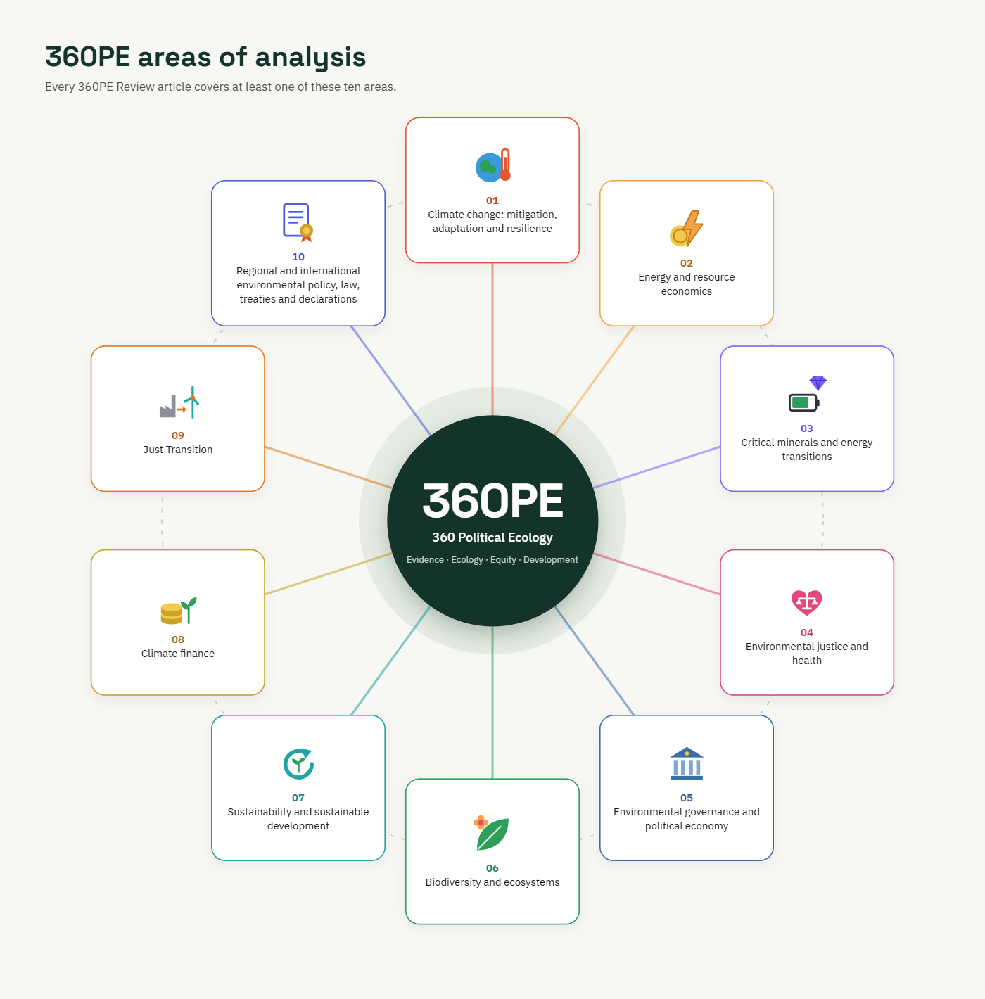

## Explore the 12 V3 research topics

The V3 knowledge architecture organizes research into **four interconnected knowledge domains and twelve thematic topics**. Select a topic to explore its key questions, related research, evidence pathways, and links to other areas. This is a navigation and discovery taxonomy; it expands, rather than replaces, the ten original areas below.

::: {.pe-v3-domain-grid}

::: {.pe-v3-domain}
### Climate, Ecology & Justice

- [Climate Change & Resilience](topics/climate-change-resilience/index.qmd)
- [Biodiversity & Ecosystems](topics/biodiversity-ecosystems/index.qmd)
- [Environmental Justice](topics/environmental-justice/index.qmd)
:::

::: {.pe-v3-domain}
### Energy, Resources & Material Systems

- [Energy Security & Transitions](topics/energy-security-transitions/index.qmd)
- [Critical Minerals & Extractives](topics/critical-minerals-extractives/index.qmd)
- [Water, Land & Food Systems](topics/water-land-food-systems/index.qmd)
:::

::: {.pe-v3-domain}
### Economics, Finance & Development

- [Environmental & Development Economics](topics/environmental-development-economics/index.qmd)
- [Sustainable Finance & Investment](topics/sustainable-finance-investment/index.qmd)
- [Sustainable Development & SDGs](topics/sustainable-development-sdgs/index.qmd)
:::

::: {.pe-v3-domain}
### Governance, Power & Transformation

- [Environmental Governance & Policy](topics/environmental-governance-policy/index.qmd)
- [Political Ecology & Geopolitics](topics/political-ecology-geopolitics/index.qmd)
- [Technology & Green Transitions](topics/technology-green-transitions/index.qmd)
:::

:::

## Foundational Ten Areas of Analysis

The ten areas below are 360PE's original analytical framework, retained with their descriptions and original infographic. They remain important to the platform's identity; V3 adds a more detailed classification system for navigating publications.

::: {.pe-topics-intro}
## Our Ten Areas of Analysis

360 Political Ecology (360PE) examines environmental and development challenges through ten interconnected thematic areas. **Every 360PE Review article addresses at least one area**, and many examine several.
:::

  <section class="pe-topic-card" role="listitem" aria-labelledby="pe-topic-01">
    01
    <h3 id="pe-topic-01">Climate change: mitigation, adaptation and resilience</h3>
    
Climate risks, emissions reduction, adaptation decisions and the resilience of societies and ecosystems.

  </section>
  <section class="pe-topic-card" role="listitem" aria-labelledby="pe-topic-02">
    02
    <h3 id="pe-topic-02">Energy and resource economics</h3>
    
Energy access, resource allocation, markets, economic incentives and development outcomes.

  </section>
  <section class="pe-topic-card" role="listitem" aria-labelledby="pe-topic-03">
    03
    <h3 id="pe-topic-03">Critical minerals and energy transitions</h3>
    
Mineral supply chains, industrial policy, technological change and the distribution of transition benefits and costs.

  </section>
  <section class="pe-topic-card" role="listitem" aria-labelledby="pe-topic-04">
    04
    <h3 id="pe-topic-04">Environmental justice and health</h3>
    
Unequal exposure, public health, community participation and the fairness of environmental decisions.

  </section>
  <section class="pe-topic-card" role="listitem" aria-labelledby="pe-topic-05">
    05
    <h3 id="pe-topic-05">Environmental governance and political economy</h3>
    
Institutions, public policy, power, incentives, accountability and contested resource decisions.

  </section>
  <section class="pe-topic-card" role="listitem" aria-labelledby="pe-topic-06">
    06
    <h3 id="pe-topic-06">Biodiversity and ecosystems</h3>
    
Ecosystem change, conservation, ecological services and the relationships between biodiversity and livelihoods.

  </section>
  <section class="pe-topic-card" role="listitem" aria-labelledby="pe-topic-07">
    07
    <h3 id="pe-topic-07">Sustainability and sustainable development</h3>
    
Long-term development pathways and trade-offs among economic, social and ecological objectives.

  </section>
  <section class="pe-topic-card" role="listitem" aria-labelledby="pe-topic-08">
    08
    <h3 id="pe-topic-08">Climate finance</h3>
    
Climate-related investment, financial mechanisms, funding access, risk allocation and accountability.

  </section>
  <section class="pe-topic-card" role="listitem" aria-labelledby="pe-topic-09">
    09
    <h3 id="pe-topic-09">Just Transition</h3>
    
Fairness for workers, communities and vulnerable groups during decarbonization and economic restructuring.

  </section>
  <section class="pe-topic-card" role="listitem" aria-labelledby="pe-topic-10">
    10
    <h3 id="pe-topic-10">Regional and international environmental policy, law, treaties and declarations</h3>
    
Environmental agreements, regional cooperation, legal frameworks and cross-border implementation challenges.

  </section>

::: {.pe-principles}
**Our guiding principles:** Evidence · Ecology · Equity · Development

The ten areas describe what 360PE studies. These four principles guide how 360PE approaches analysis and public communication.
:::

## The 360PE analytical framework

{fig-alt="Ten labeled thematic areas arranged around a central 360PE circle: climate change; energy and resource economics; critical minerals and energy transitions; environmental justice and health; environmental governance and political economy; biodiversity and ecosystems; sustainability and sustainable development; climate finance; Just Transition; and regional and international environmental policy, law, treaties and declarations." width="100%"}

*Figure 1. The ten thematic areas of analysis of 360 Political Ecology (360PE).* 

*Note.* This conceptual diagram illustrates thematic membership in 360PE's analytical framework. Connecting lines do not indicate causal or empirically measured relationships. Each 360PE Review article addresses at least one of the ten areas. *Source:* 360 Political Ecology (2026), original framework.

[Browse articles in 360PE Review](publications.qmd)
